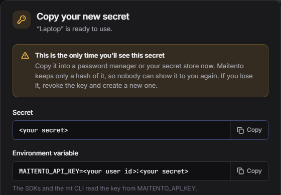

# 2. Create an API key

Your code signs in to Maitento with an **API key**. It acts as you, with your permissions.

1. In the portal, open **Settings → API keys** and choose **Create API key**. Give it a name, and an expiry date if
   you like.
2. Copy the line labelled **Environment variable**:

   

   It looks like this:

   ```text
   MAITENTO_API_KEY=<your user id>:<your secret>
   ```

   It's two values joined by a colon: your **user id**, and the key's **secret**. The secret is shown only this
   once, so put it somewhere safe, such as a password manager or your secret store.

## Set the environment variables

The SDKs and the `mt` command line read the key from `MAITENTO_API_KEY`, and the namespace to work in from
`MAITENTO_NAMESPACE`. The tutorials use a namespace called `tutorials`:

<!-- tabs -->
```bash title="macOS and Linux"
export MAITENTO_API_KEY="<user id>:<secret>"
export MAITENTO_NAMESPACE="tutorials"
```
```powershell title="Windows"
$env:MAITENTO_API_KEY = "<user id>:<secret>"
$env:MAITENTO_NAMESPACE = "tutorials"
```
<!-- /tabs -->

## Check it works

<!-- tabs -->
<!-- snippet: examples/00-connect/typescript/whoami.ts -->
```ts title="TypeScript"
import { Maitento } from "@maitento/sdk";

// Reads your API key from MAITENTO_API_KEY.
const mt = new Maitento();

// Who the key belongs to, and which models you can use.
const me = await mt.users.self();
console.log(`Signed in as ${me.user.name} <${me.user.emailAddress}> in ${me.tenant.name}.`);

const models = await mt.models.list();
console.log(`${models.length} models available, for example ${models.slice(0, 3).map((m) => m.name).join(", ")}.`);
```
<!-- /snippet -->
<!-- snippet: examples/00-connect/python/whoami.py -->
```python title="Python"
from maitento import Maitento

# Reads your API key from MAITENTO_API_KEY.
mt = Maitento()

# Who the key belongs to, and which models you can use.
me = mt.users.self()
print(f"Signed in as {me.user.name} <{me.user.email_address}> in {me.tenant.name}.")

models = mt.models.list()
print(f"{len(models)} models available, for example {', '.join(m.name for m in models[:3])}.")
```
<!-- /snippet -->
<!-- snippet: examples/00-connect/csharp/whoami.cs -->
```csharp title="C#"
#:package Maitento.Sdk@26.10.0

using Maitento.Sdk;

// Reads your API key from MAITENTO_API_KEY.
await using var mt = MaitentoClient.CreateFromEnvironment();

// Who the key belongs to, and which models you can use.
var me = await mt.Users.GetSelfAsync();
Console.WriteLine($"Signed in as {me.User.Name} <{me.User.EmailAddress}> in {me.Tenant.Name}.");

var models = await mt.AiModels.GetAllAsync();
var examples = string.Join(", ", models.Take(3).Select(m => m.Name));
Console.WriteLine($"{models.Length} models available, for example {examples}.");
```
<!-- /snippet -->
```bash title="CLI"
# mt reads MAITENTO_API_KEY itself.
mt aimodel-list
```
```bash title="curl"
export MAITENTO_AUTH="ApiKey ${MAITENTO_API_KEY/:/ }"
curl https://api.maitento.com/users/self -H "Authorization: $MAITENTO_AUTH"
```
<!-- /tabs -->

```text
Signed in as Ana Silva <ana@example.com> in Acme.
51 models available, for example anthropic.fable-5, anthropic.fable-5.1, anthropic.haiku-4.5.
```

## Calling the API directly

Without an SDK, send the key in the `Authorization` header: the word `ApiKey`, your user id, and the secret,
separated by spaces:

```http
Authorization: ApiKey <your user id> <your secret>
```

The curl examples in these docs use `$MAITENTO_AUTH`, set as above. `${MAITENTO_API_KEY/:/ }` swaps the colon for a
space.

## Keeping keys safe

- **One key per use.** Make separate keys for your laptop, CI and each service, so you can revoke one without
  breaking the others.
- **Never put a key in source code** or a project file. Use your platform's secret store.
- **Revoke a key** you no longer need, or one that may have leaked, from **Settings → API keys**.

**Next:** [3. Add a model key](3-model-key.md).
