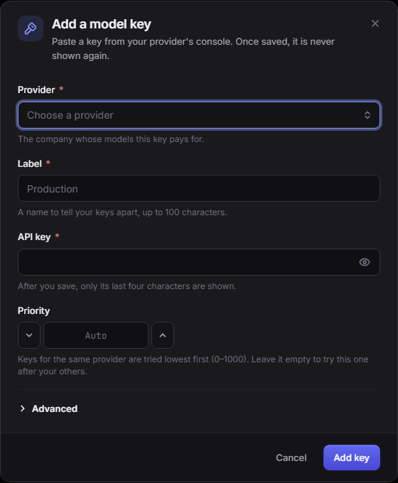
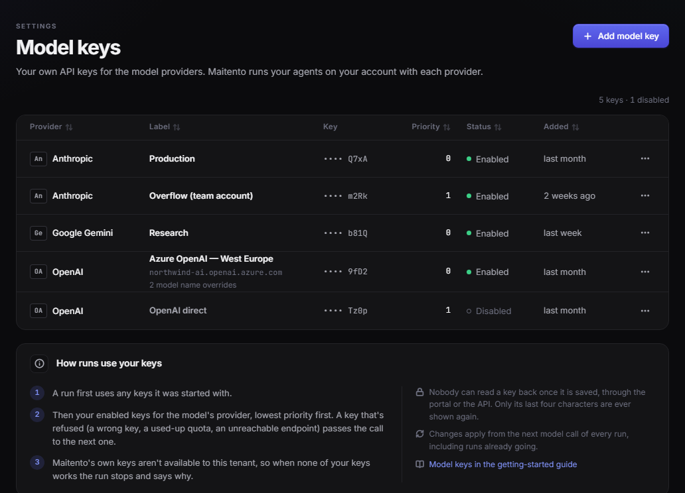

# 3. Add a model key

Maitento calls models from providers such as OpenAI, Anthropic and DeepSeek on **your account** with that provider.
Add your provider's API key once, and every run uses it.

The tutorials use DeepSeek's `deepseek-v4-flash`, which is fast and inexpensive. Get a key from the
[DeepSeek platform](https://platform.deepseek.com) and add it. For the knowledge and memory tutorials, add an
**OpenAI** key as well: they need embeddings, which DeepSeek doesn't offer.

## In the portal

Open **Settings → Model keys**, choose **Add model key**, pick the provider, give it a label and paste the key. Only
tenant admins can add keys.



The page lists your keys, with only their last four characters, and explains the order a run tries them in:



## Or with code

<!-- tabs -->
```ts title="TypeScript"
await mt.modelKeys.create({ provider: "DeepSeek", label: "Tutorials", apiKey: process.env.DEEPSEEK_API_KEY! });
```
```python title="Python"
mt.model_keys.create(provider="DeepSeek", label="Tutorials", api_key=os.environ["DEEPSEEK_API_KEY"])
```
```csharp title="C#"
await mt.ModelKeys.CreateAsync(ModelKeyProvider.DeepSeek, "Tutorials", Environment.GetEnvironmentVariable("DEEPSEEK_API_KEY")!);
```
```bash title="curl"
curl -X POST https://api.maitento.com/tenants/self/model-keys \
  -H "Authorization: $MAITENTO_AUTH" -H "Content-Type: application/json" \
  -d '{"provider": "DeepSeek", "label": "Tutorials", "apiKey": "'"$DEEPSEEK_API_KEY"'"}'
```
<!-- /tabs -->

The providers are `OpenAi`, `Anthropic`, `DeepSeek`, `Gemini`, `Qwen`, `Glm` and `Kimi`.

## Good to know

- **A key can't be read back** once it's saved: Maitento only ever shows its last four characters.
- **Several keys for one provider** are tried in priority order, so a refused or exhausted key passes the call to the
  next one.
- **A run with no key for its model's provider fails straight away** and says so. Its failure details end with
  `[api:model-keys:none-for-provider]`, and the portal shows a button to add one.

More in [Models and model keys](../concepts/models-and-keys.md).

**Next:** [4. Install an SDK or the CLI](4-install.md).
