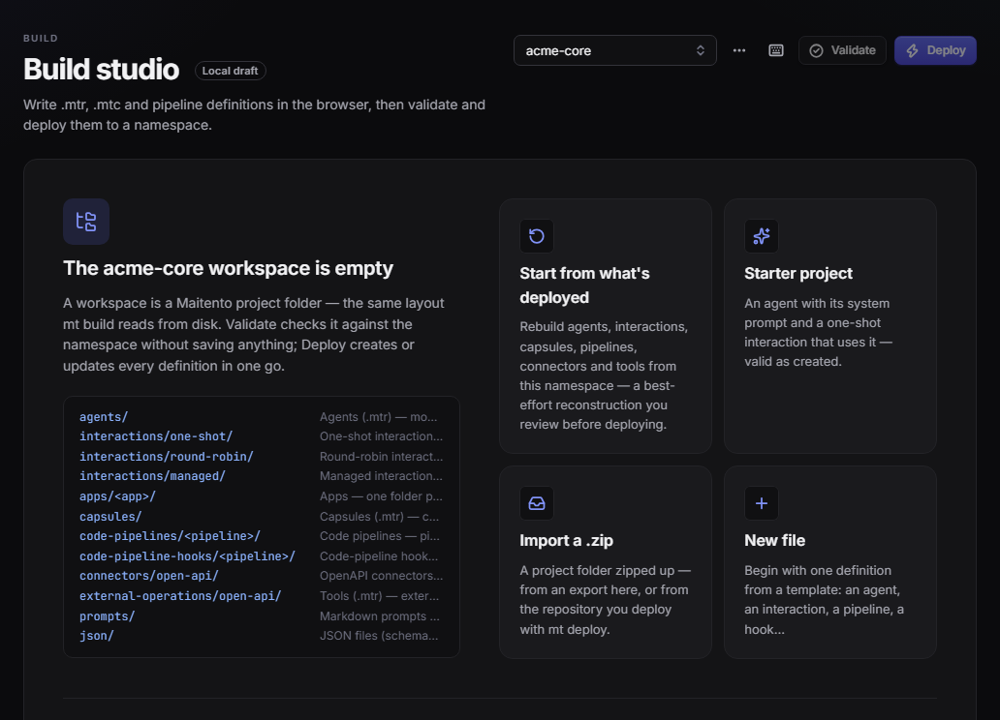

# 4. Install an SDK or the CLI

Use whichever suits you. They all do the same things, and the docs show each one side by side.

<!-- tabs -->
```bash title="TypeScript"
# Node.js 20 or later, Bun, Deno or a modern browser. No other dependencies.
npm install @maitento/sdk
```
```bash title="Python"
# Python 3.10 or later.
pip install maitento
```
```bash title="C#"
# .NET 8 or later.
dotnet add package Maitento.Sdk
```
```bash title="CLI"
# The mt command line. Installing it needs the .NET SDK, 8 or later.
dotnet tool install --global Maitento.Shell
mt help
```
<!-- /tabs -->

`mt` reads your key and namespace from the same `MAITENTO_API_KEY` and `MAITENTO_NAMESPACE` variables as the SDKs.
[The mt command line](../reference/cli/index.md) covers the rest: signing in, running it as an interactive shell,
paths, output and exit codes. Or skip installing it: the portal's **cloud shell**, the **>_** button in the top bar,
runs the same `mt` in your browser.

## Using another language

Every SDK is a thin layer over the Maitento HTTP API, and every API call in the [reference](../reference/index.md)
shows the plain HTTP request and the curl command. Authenticate with the `Authorization: ApiKey <user id> <secret>`
header from [step 2](2-api-key.md#calling-the-api-directly), send and receive JSON, and you can use Maitento from
anything.

## The portal's Build studio

You don't need to install anything to write and deploy agents: the portal's **Build studio** has an editor with the
same folder layout as a project on your disk, with **Validate** and **Deploy** buttons. You can import and export a
project as a `.zip`.



**Next:** [5. Run your first agent](5-first-agent.md).
