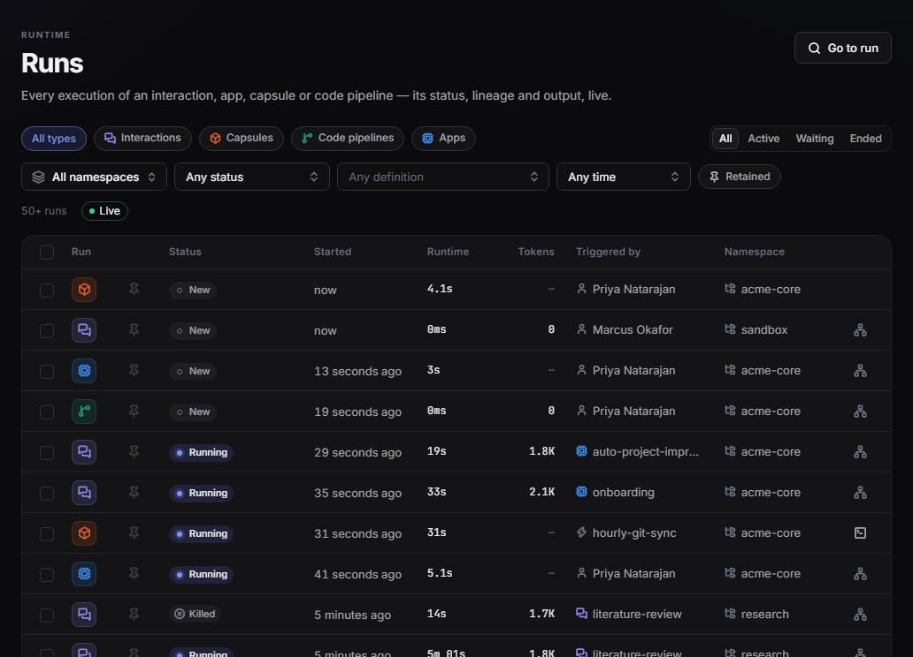

# 5. Run your first agent

Make a folder called `maitento` with two files in it.

An **agent**: a model and its instructions.

<!-- snippet: examples/01-hello-agent/maitento/agents/greeter.mtr -->
```hcl title="maitento/agents/greeter.mtr"
// The model this agent runs on. See the names you can use with `mt aimodel-list`.
model = @ref("deepseek.deepseek-v4-flash")
prompt = "You are a friendly assistant. Keep every answer to one or two sentences."
summary = "A friendly assistant"
```
<!-- /snippet -->

An **interaction**: the job to run, which puts the agent to work on a task.

<!-- snippet: examples/01-hello-agent/maitento/interactions/one-shot/hello.mtr -->
```hcl title="maitento/interactions/one-shot/hello.mtr"
// A one-shot interaction: one agent, one task, one answer.
agent = {
  name = "Greeter"
  agent = @ref("greeter")
}
task = "Hello, how are you?"
```
<!-- /snippet -->

Then deploy the folder and run the interaction:

<!-- tabs -->
<!-- snippet: examples/01-hello-agent/typescript/hello.ts -->
```ts title="TypeScript"
import { Maitento } from "@maitento/sdk";

// Reads your API key and namespace from MAITENTO_API_KEY and MAITENTO_NAMESPACE.
const mt = new Maitento();

// Send the agent and the interaction in ../maitento to Maitento.
await mt.deploy("../maitento");

// Start the "hello" interaction and wait for its answer.
const run = await mt.interactions.run("hello");
console.log(run.output);
```
<!-- /snippet -->
<!-- snippet: examples/01-hello-agent/python/hello.py -->
```python title="Python"
from maitento import Maitento

# Reads your API key and namespace from MAITENTO_API_KEY and MAITENTO_NAMESPACE.
mt = Maitento()

# Send the agent and the interaction in ../maitento to Maitento.
mt.deploy("../maitento")

# Start the "hello" interaction and wait for its answer.
run = mt.interactions.run("hello")
print(run.output)
```
<!-- /snippet -->
<!-- snippet: examples/01-hello-agent/csharp/hello.cs -->
```csharp title="C#"
#:package Maitento.Sdk@26.10.0

using Maitento.Sdk;

// Reads your API key and namespace from MAITENTO_API_KEY and MAITENTO_NAMESPACE.
await using var mt = MaitentoClient.CreateFromEnvironment();

// Send the agent and the interaction in ../maitento to Maitento.
await mt.DeployAsync("../maitento");

// Start the "hello" interaction and wait for its answer.
var run = await mt.Interactions.RunAsync("hello");
Console.WriteLine(run.Output);
```
<!-- /snippet -->
```bash title="CLI"
mt deploy ./maitento
mt interaction-run hello
```
```bash title="curl"
# Deploying is easiest with an SDK or the CLI. Once deployed, starting a run is one call:
curl -X PUT https://api.maitento.com/namespaces/tutorials/interactions/by-name/hello/start \
  -H "Authorization: $MAITENTO_AUTH" -H "Content-Type: application/json" -d '{"inputs": []}'
```
<!-- /tabs -->

```text
I am well, thank you for asking. How may I assist you with your task today?
```

That's a working Maitento agent. Open **Runs** in the portal to see the run: its conversation, how long it took and
the tokens it used.



## What the CLI shows

`mt deploy` lists what it found, compiles it, and says what changed. Deploying again changes nothing, and says
`Unchanged` instead of `Created`:

```text
$ mt deploy ./maitento
Starting build in /local/projects/hello/maitento
Discovered greeter in agents
Discovered hello in interactions/one-shot
Calling Maitento build service in namespace tutorials
<13:11:53.356>       (greeter.mtr) Starting compilation of greeter.mtr
<13:11:53.356>       Compilation complete in 00:00:00.0001393
<13:11:53.356>       (hello.mtr) Starting compilation of hello.mtr
<13:11:53.356>       Compilation complete in 00:00:00.0001906

Created: Agent greeter (e90fa2a7-b363-480d-972b-3b894c7a1429)
Created: OneShotInteraction hello (29675b08-d94d-4ff1-92b7-eb1f3646011b)

Deployed to namespace 'tutorials' in 327ms: 2 created.
  Agent               1 created
  OneShotInteraction  1 created
Build pipeline complete
```

`mt interaction-run` starts the run, follows it live, and prints the answer:

```text
$ mt interaction-run hello
Connecting to notification system...
Connected to notification system
Requesting interaction start...
Started 'hello@tutorials' with pid 197d0f44-26bd-45ce-9259-9cf61981ad0c
Status: Running
Waiting for interaction... (Ctrl+C stops watching; the run carries on)
[Greeter] I am functioning well, thank you for asking. How may I assist you with your task today?
Output: I am functioning well, thank you for asking. How may I assist you with your task today?
Status: Finished
```

If something is wrong in a file, `mt deploy` names the file and the problem, deploys nothing, and exits with a
non-zero code, so a CI job stops there. Here `hello.mtr` points at an agent that doesn't exist:

```text
<13:12:25.259> [ERR] (hello.mtr) Unable to resolve resource reference for agent 'no-such-agent'
Build failed in 00:00:00.2970885
```

`mt build ./maitento` runs the same checks without deploying anything.

## Where next

- **[The tutorials](../tutorials/index.md)** carry on from here, one idea at a time: inputs, JSON answers, runs,
  streaming, teams of agents, chat, tools, your own code, approvals, webhooks, live events, your documents, the web,
  files, apps, schedules, memory, sandboxes and code pipelines.
- **[How Maitento works](../concepts/index.md)** explains the ideas behind it on one page.
