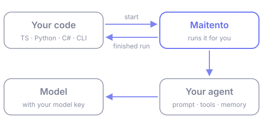

# Get started

You'll need about ten minutes. By the end, an agent you wrote answers a call from your own code.

1. [**Get access.**](1-access.md) Sign up for a tenant on the Free plan, and sign in to the portal.
2. [**Create an API key**](2-api-key.md) in the portal and put it in an environment variable.
3. [**Add a model key.**](3-model-key.md) Maitento runs your agents on your own account with the model provider.
4. [**Install an SDK or the CLI.**](4-install.md) TypeScript, Python, C#, or the `mt` command line.
5. [**Run your first agent.**](5-first-agent.md) Write two small files, deploy them, and run them.

Then carry on with the [tutorials](../tutorials/index.md), which build up from there to code pipelines and a small
support desk.

Working with an AI coding agent such as Claude Code, Codex or Cursor? Give it the Maitento skill first:
[Build with an AI coding agent](../guides/ai-coding-agents.md). Agents haven't seen `.mtr` files or Cogniscript
before, and the skill teaches them both.
