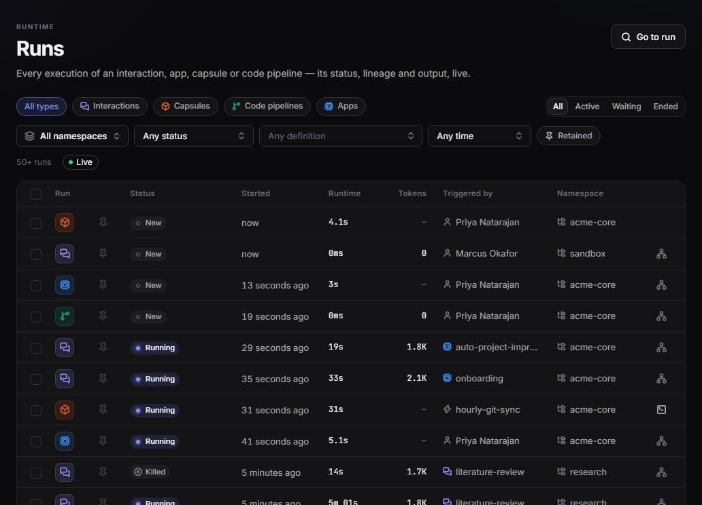

# 1. Hello, agent

Every Maitento project works the same way: you write a few small text files, deploy them, and start a run from your
code. This lesson goes through that loop once, slowly, with an agent that answers "Hello, how are you?". If you did
[Get started](../get-started/5-first-agent.md), you have already run this code. This time you'll see what each part
does, because every later tutorial builds on it.

> **You'll learn**
>
> - what an agent is, and what an interaction is
> - what a deploy does, and why deploying twice changes nothing
> - what a run is, how to read its answer, and where to find it in the portal
>
> **New concepts:** [agents](../concepts/agents.md) · [interactions](../concepts/interactions.md) ·
> [projects and deploys](../concepts/projects-and-deploys.md) · [runs](../concepts/runs-and-events.md)
>
> **Builds on:** [Get started](../get-started/index.md)
>
> **Time:** ~10 min · **Cost:** under $0.01 on DeepSeek · **Needs:** nothing beyond Get started

## 1. Write the agent

An **agent** is a model with standing instructions. It is a definition: it does nothing until something puts it to
work.

<!-- snippet: examples/01-hello-agent/maitento/agents/greeter.mtr -->
```hcl title="maitento/agents/greeter.mtr"
// The model this agent runs on. See the names you can use with `mt aimodel-list`.
model = @ref("deepseek.deepseek-v4-flash")
prompt = "You are a friendly assistant. Keep every answer to one or two sentences."
summary = "A friendly assistant"
```
<!-- /snippet -->

- `model` is the model it runs on. Maitento calls it with your [model key](../concepts/models-and-keys.md) for that
  provider.
- `prompt` is the system prompt: who the agent is and how it behaves, in every job it does.
- `summary` is one line about the agent for other agents, such as a router choosing who should answer
  ([tutorial 6](06-routed-agents.md)). Every agent needs one.

The folder says what a file is, and the file name is its name: `agents/greeter.mtr` is the agent `greeter`.

## 2. Write the interaction

An **interaction** is a job you can run. It says who takes part and what they work on. This one seats the greeter,
gives it one task and returns one answer, so it is a *one-shot* interaction, in `interactions/one-shot/`:

<!-- snippet: examples/01-hello-agent/maitento/interactions/one-shot/hello.mtr -->
```hcl title="maitento/interactions/one-shot/hello.mtr"
// A one-shot interaction: one agent, one task, one answer.
agent = {
  name = "Greeter"
  agent = @ref("greeter")
}
task = "Hello, how are you?"
```
<!-- /snippet -->

`agent` is the seat. `name` is what the agent is called in this interaction, and `@ref("greeter")` says which agent
sits there. An `@ref` points at another definition by its name.

Why two files? The agent is *who*, the interaction is *what to do*. Keeping them apart means one agent can do many
jobs: the challenge at the end gives the greeter a second one.

**Done when:** your project folder holds these two files:

```text
maitento/
├── agents/
│   └── greeter.mtr
└── interactions/
    └── one-shot/
        └── hello.mtr
```

## 3. Deploy it and run it

The script deploys the folder, then runs the interaction and prints the answer. The CLI does the same in two commands.

<!-- tabs -->
<!-- snippet: examples/01-hello-agent/typescript/hello.ts -->
```ts title="TypeScript"
import { Maitento } from "@maitento/sdk";

// Reads your API key and namespace from MAITENTO_API_KEY and MAITENTO_NAMESPACE.
const mt = new Maitento();

// Send the agent and the interaction in ../maitento to Maitento.
await mt.deploy("../maitento");

// Start the "hello" interaction and wait for its answer.
const run = await mt.interactions.run("hello");
console.log(run.output);
```
<!-- /snippet -->
<!-- snippet: examples/01-hello-agent/python/hello.py -->
```python title="Python"
from maitento import Maitento

# Reads your API key and namespace from MAITENTO_API_KEY and MAITENTO_NAMESPACE.
mt = Maitento()

# Send the agent and the interaction in ../maitento to Maitento.
mt.deploy("../maitento")

# Start the "hello" interaction and wait for its answer.
run = mt.interactions.run("hello")
print(run.output)
```
<!-- /snippet -->
<!-- snippet: examples/01-hello-agent/csharp/hello.cs -->
```csharp title="C#"
#:package Maitento.Sdk@26.10.0

using Maitento.Sdk;

// Reads your API key and namespace from MAITENTO_API_KEY and MAITENTO_NAMESPACE.
await using var mt = MaitentoClient.CreateFromEnvironment();

// Send the agent and the interaction in ../maitento to Maitento.
await mt.DeployAsync("../maitento");

// Start the "hello" interaction and wait for its answer.
var run = await mt.Interactions.RunAsync("hello");
Console.WriteLine(run.Output);
```
<!-- /snippet -->
```bash title="CLI"
mt deploy ./maitento
mt interaction-run hello
```
<!-- /tabs -->

### Run it

The finished project is [`examples/01-hello-agent`](../../examples/01-hello-agent/) in the public repo. Run the
script from its own folder, because `../maitento` is relative to where you run it:

<!-- tabs -->
```bash title="TypeScript"
cd examples/01-hello-agent/typescript
npm install
node hello.ts
```
```bash title="Python"
cd examples/01-hello-agent/python
pip install -r requirements.txt
python hello.py
```
```bash title="C#"
cd examples/01-hello-agent/csharp
dotnet run hello.cs
```
```bash title="CLI"
cd examples/01-hello-agent
mt deploy ./maitento
mt interaction-run hello
```
<!-- /tabs -->

**Done when:** a one- or two-sentence reply is printed, something like this. The model writes it fresh each time, so
your words will differ:

```text
I am functioning well, thank you for asking. How may I assist you with your task today?
```

## 4. What the deploy did

`deploy` sent the whole folder to Maitento as one **build**. Maitento compiled every file and checked every `@ref`,
and only then saved anything: version 1 of the agent `greeter` and of the interaction `hello`, in your namespace. If
any file is wrong, nothing is saved.

Deploy the same files again and nothing changes. The CLI shows it:

```text
$ mt deploy ./maitento
Discovered greeter in agents
Discovered hello in interactions/one-shot
Calling Maitento build service in namespace tutorials
...
Unchanged: Agent greeter (28c7349b-616b-43ba-af37-c57b5f979989)
Unchanged: OneShotInteraction hello (5d6a867c-ae09-48a4-9886-5140518ed130)

Deployed to namespace 'tutorials' in 583ms: 2 unchanged.
```

Change a file and deploy, and that definition gets a new version. The old versions are kept.

## 5. What a run is

`run("hello")` did two things:

1. It **started a run**: one execution of the interaction, with its own id. A Maitento worker sent the task to
   DeepSeek with your model key, and saved the reply.
2. It **waited** until the run had finished, then returned it. The reply is in `output`.


A run is a record that stays after it ends: its status, the conversation, how long it took and the tokens it used.
In the API a run is called a **process**, which is why the CLI prints a `pid`:

```text
$ mt interaction-run hello
Connecting to notification system...
Connected to notification system
Requesting interaction start...
Started 'hello@tutorials' with pid c2317a22-d579-47cc-8ed1-28357750ad8c
Status: Running
Waiting for interaction... (Ctrl+C stops watching; the run carries on)
[Greeter] I'm doing well, thank you for asking. How can I assist you today?
Output: I'm doing well, thank you for asking. How can I assist you today?
Status: Finished
```

`[Greeter]` is the seat's name from `hello.mtr`. [Tutorial 4](04-runs.md) starts runs without waiting for them, and
checks on them later.

## 6. Find the run in the portal

Open **Runs** in the [portal](https://app.maitento.com). Every run in your tenant is listed, newest first, with its
status, when it started, how long it ran and the tokens it used.



**Done when:** you can open your `hello` run and read the Greeter's reply in its conversation.

## All the files

<!-- project: examples/01-hello-agent -->
**On GitHub:** [`examples/01-hello-agent`](https://github.com/maitento/maitento/tree/main/examples/01-hello-agent) · [TypeScript](https://github.com/maitento/maitento/tree/main/examples/01-hello-agent/typescript) · [Python](https://github.com/maitento/maitento/tree/main/examples/01-hello-agent/python) · [C#](https://github.com/maitento/maitento/tree/main/examples/01-hello-agent/csharp)

<details>
<summary>All the files in this project (2)</summary>

<!-- tabs: files -->
**`maitento/agents/greeter.mtr`**
```hcl title="maitento/agents/greeter.mtr"
// The model this agent runs on. See the names you can use with `mt aimodel-list`.
model = @ref("deepseek.deepseek-v4-flash")
prompt = "You are a friendly assistant. Keep every answer to one or two sentences."
summary = "A friendly assistant"
```

**`maitento/interactions/one-shot/hello.mtr`**
```hcl title="maitento/interactions/one-shot/hello.mtr"
// A one-shot interaction: one agent, one task, one answer.
agent = {
  name = "Greeter"
  agent = @ref("greeter")
}
task = "Hello, how are you?"
```
<!-- /tabs -->

</details>

<!-- /project -->

## Break it on purpose

Misspell the agent's name in `hello.mtr`, so the seat points at an agent that doesn't exist:

```hcl
  agent = @ref("greter")
```

Run the script again. The deploy refuses the whole folder, names the file and the reference, and saves nothing, so
the run never starts:

<!-- tabs -->
```text title="TypeScript"
BuildFailedError: The build failed with 1 error(s). First: Unable to resolve resource reference for agent 'greter' (hello.mtr)
```
```text title="Python"
maitento.errors.BuildFailedError: The build failed; nothing was deployed:
  hello.mtr Unable to resolve resource reference for agent 'greter'
```
```text title="C#"
Unhandled exception. Maitento.Sdk.Exceptions.MaitentoBuildFailedException: The build failed with 1 error(s). First: Unable to resolve resource reference for agent 'greter' (hello.mtr)
```
```text title="CLI"
<19:14:43.722> [ERR] (hello.mtr) Unable to resolve resource reference for agent 'greter'
Build failed in 00:00:00.3056648
```
<!-- /tabs -->

This is why a deploy checks the folder as a whole: a broken reference is caught before anything runs. Put the name
back and run it again.

## If it didn't work

- **`No namespace`** (TypeScript, C#) or **`This call needs a namespace`** (Python): `MAITENTO_NAMESPACE` isn't set
  in this terminal. Set it to `tutorials` and run again.
- **`No credential`** (TypeScript) or **`No credentials`** (Python): `MAITENTO_API_KEY` isn't set. It holds
  `<user id>:<secret>`, as [Get started](../get-started/2-api-key.md) shows.
- **`Project folder not found: ../maitento`** (TypeScript, C#) or **`../maitento is not a directory`** (Python): the
  script was run from another folder. `cd` into `typescript/`, `python/` or `csharp/` first.
- **`Unknown file extension ".ts"`**: your Node.js is older than 22.18, which can't run TypeScript directly. Check
  with `node --version` and upgrade.
- **The run ends with `[api:model-keys:none-for-provider]`**: there is no model key for the agent's provider:

  ```text
  ProcessFailedError: Interaction run 6422bf07-1913-4e6c-8a42-391b49d42f11 ended Error: No model key is configured for provider 'DeepSeek'. Add one under Settings → Model keys (or POST /tenants/self/model-keys). Or allow the run to use Maitento's own key (allowMaitentoFallback). [api:model-keys:none-for-provider]
  ```

  Add a DeepSeek key ([Get started, step 3](../get-started/3-model-key.md)), or change `model` to a model you have a
  key for.
- **`No Set node determined (hello.mtr:6)`**: a line in a `.mtr` file has no spaces around `=`, such as
  `task="Hello"`. Write `task = "Hello"`.

## Review

You built:

- an agent (who) and a one-shot interaction (what to do), in a project folder;
- a deploy that checks the folder as a whole and saves new versions only of what changed;
- a run, read from code, from the CLI and in the portal.

The concepts:

- [Agent](../concepts/agents.md): a model, a system prompt and a summary. It does nothing on its own.
- [Interaction](../concepts/interactions.md): the job you run. A one-shot interaction is one agent, one task, one
  answer.
- [Deploy](../concepts/projects-and-deploys.md): sends the whole folder; nothing is saved unless every file is right.
- [Run](../concepts/runs-and-events.md): one execution, with an id, a status and an `output`. A process, in the API.

**Challenge:** give the greeter a second job. Add an interaction `joke` that asks it for a short joke about computers,
and run it, without changing `greeter.mtr`. The solution is in
[`examples/01-hello-agent/solution`](../../examples/01-hello-agent/solution/).

**Next:** [2. Prompts and inputs](02-prompts-and-inputs.md) makes the task take values from your code.
