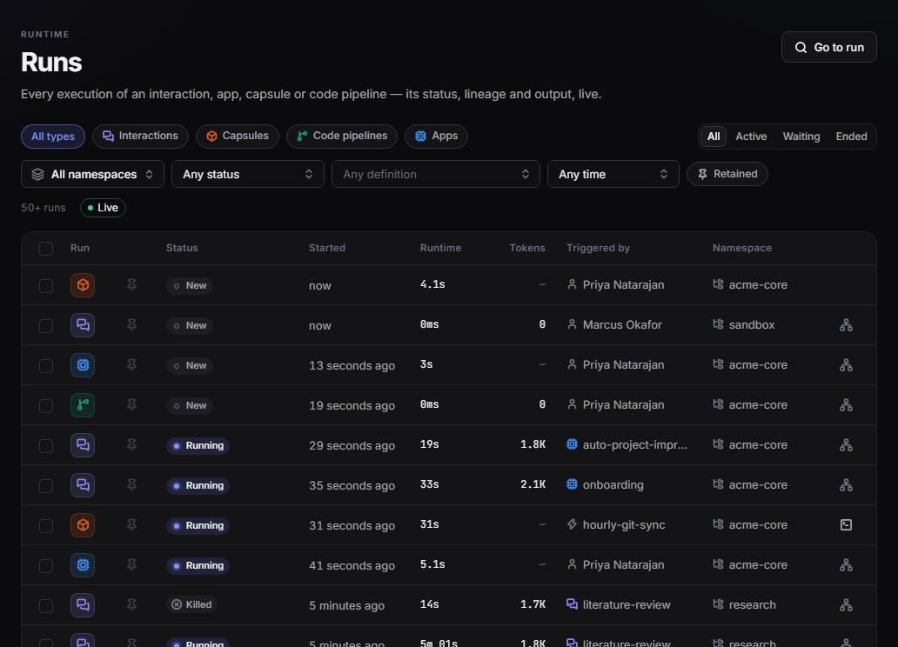

# 4. Runs

Every time an interaction runs, Maitento keeps a record of it: a **run**. In tutorials 1 to 3, `run()` started one
and waited for its answer in a single call. Here you take that apart. You'll start a run and let your script end
while the agent works, check on it from another script, list your recent runs, wait for one yourself, and stop one
half-way. You need this as soon as an answer takes longer than anyone wants to wait, or your code has other work to
do in the meantime.

> **You'll learn**
>
> - starting a run without waiting for it
> - reading a run back by its id, and what its status tells you
> - listing your runs a page at a time
> - waiting for a run yourself, and what `run()` does for you
> - cancelling a run
>
> **New concepts:** [runs and their statuses](../concepts/runs-and-events.md) ·
> **Builds on:** [1. Hello, agent](01-hello-agent.md) ·
> **Time:** about 15 minutes ·
> **Cost:** under $0.01 on DeepSeek ·
> **Needs:** nothing beyond tutorial 1's setup

In the API and the SDKs a run is called a **process**: you'll see `InteractionProcess` and
`/interactions/processes/…`. It's the same thing.

## 1. The project

An agent that explains things simply:

<!-- snippet: examples/04-runs/maitento/agents/explainer.mtr -->
```hcl title="maitento/agents/explainer.mtr"
model = @ref("deepseek.deepseek-v4-flash")
prompt = "You explain things clearly and simply, to a curious twelve-year-old."
summary = "Explains a topic in plain words"
```
<!-- /snippet -->

And an interaction that asks for about 400 words. That takes a few seconds to write, so there's time to look at the
run while it works:

<!-- snippet: examples/04-runs/maitento/interactions/one-shot/explain.mtr -->
```hcl title="maitento/interactions/one-shot/explain.mtr"
agent = {
  name = "Explainer"
  agent = @ref("explainer")
}
// Long enough to take a few seconds, so there is time to look at the run while it works.
task = "Explain %%topic%% in about 400 words."
inputs.prompts = [
  {
    name = "topic"
    description = "What to explain"
    required = true
  }
]
```
<!-- /snippet -->

Run every script from its language folder, as in [tutorial 1](01-hello-agent.md#run-it):
`examples/04-runs/typescript` (after `npm install`), `examples/04-runs/python` (after
`pip install -r requirements.txt`) or `examples/04-runs/csharp`.

## 2. Start a run without waiting

`start()` asks Maitento for a run and returns it straight away, in status `New`. The agent hasn't begun yet, and your
script doesn't wait for it to: once Maitento has the run, it carries on whether your code is still there or not.

<!-- tabs -->
<!-- snippet: examples/04-runs/typescript/start.ts -->
```ts title="TypeScript"
import { Maitento } from "@maitento/sdk";

const mt = new Maitento();
await mt.deploy("../maitento");

// start() returns as soon as Maitento has the run. It doesn't wait for the answer.
const run = await mt.interactions.start("explain", { inputs: { topic: "why the sky is blue" } });

console.log(`Started run ${run.id}: ${run.status}`);
console.log(`Check on it with: node status.ts ${run.id}`);
```
<!-- /snippet -->
<!-- snippet: examples/04-runs/python/start.py -->
```python title="Python"
from maitento import Maitento

mt = Maitento()
mt.deploy("../maitento")

# start() returns as soon as Maitento has the run. It doesn't wait for the answer.
run = mt.interactions.start("explain", inputs={"topic": "why the sky is blue"})

print(f"Started run {run.id}: {run.status}")
print(f"Check on it with: python status.py {run.id}")
```
<!-- /snippet -->
<!-- snippet: examples/04-runs/csharp/start.cs -->
```csharp title="C#"
#:package Maitento.Sdk@26.10.0

using Maitento.Entities.Database;
using Maitento.Sdk;

await using var mt = MaitentoClient.CreateFromEnvironment();
await mt.DeployAsync("../maitento");

// StartAsync returns as soon as Maitento has the run. It doesn't wait for the answer.
var run = await mt.InteractionProcesses.StartAsync(mt.DefaultNamespace!, "explain",
    [new NameValuePair("topic", "why the sky is blue")]);

Console.WriteLine($"Started run {run.Id}: {run.Status}");
Console.WriteLine($"Check on it with: dotnet run status.cs {run.Id}");
```
<!-- /snippet -->
```bash title="CLI"
mt deploy ./maitento
mt interaction-start explain --input-topic "why the sky is blue"
```
```bash title="curl"
curl -X PUT https://api.maitento.com/namespaces/tutorials/interactions/by-name/explain/start \
  -H "Authorization: $MAITENTO_AUTH" -H "Content-Type: application/json" \
  -d '{"inputs": [{"name": "topic", "value": "why the sky is blue"}]}'
```
<!-- /tabs -->

In C#, starting without waiting is `InteractionProcesses.StartAsync`, and it takes the namespace:
`mt.DefaultNamespace` is the one in `MAITENTO_NAMESPACE`.

```text
Started run 96187005-005d-4d06-83ec-fa9d767414bb: New
Check on it with: node status.ts 96187005-005d-4d06-83ec-fa9d767414bb
```

**Done when:** you see a run id and `New`, and the script has ended. Copy the id for the next step.

## 3. Read it back

Pass the id to `status.ts`. It reads the run as it is right now. Once the run has finished, it also reads the run's
summary for the tokens it used:

<!-- tabs -->
<!-- snippet: examples/04-runs/typescript/status.ts -->
```ts title="TypeScript"
import { Maitento } from "@maitento/sdk";

const id = process.argv[2];
if (!id) throw new Error("Pass the id of a run: node status.ts <run id>");

const mt = new Maitento();

// The run as it is right now.
const run = await mt.interactionRuns.get(id);
console.log(`Run ${run.id}: ${run.status}`);

if (run.status === "Finished") {
  // runs.get() gives a short summary of any kind of run, with the tokens it used.
  const summary = await mt.runs.get(id);
  const seconds = (run.executionTime / 1000).toFixed(1);
  console.log(`Worked for ${seconds}s, using ${summary.tokens?.input} tokens in and ${summary.tokens?.output} out.`);
  // The start of the answer.
  console.log(`${run.output?.slice(0, 160)}…`);
} else if (run.status === "Error" || run.status === "Killed") {
  console.log(`It stopped: ${run.failureDetails}`);
}
```
<!-- /snippet -->
<!-- snippet: examples/04-runs/python/status.py -->
```python title="Python"
import sys

from maitento import Maitento

if len(sys.argv) < 2:
    sys.exit("Pass the id of a run: python status.py <run id>")
run_id = sys.argv[1]

mt = Maitento()

# The run as it is right now.
run = mt.interaction_runs.get(run_id)
print(f"Run {run.id}: {run.status}")

if run.status == "Finished":
    # runs.get() gives a short summary of any kind of run, with the tokens it used.
    tokens = mt.runs.get(run_id).tokens
    assert tokens is not None  # interaction runs always count them
    seconds = run.execution_time.total_seconds()
    print(f"Worked for {seconds:.1f}s, using {tokens.input} tokens in and {tokens.output} out.")
    # The start of the answer.
    print(f"{(run.output or '')[:160]}…")
elif run.status in ("Error", "Killed"):
    print(f"It stopped: {run.failure_details}")
```
<!-- /snippet -->
<!-- snippet: examples/04-runs/csharp/status.cs -->
```csharp title="C#"
#:package Maitento.Sdk@26.10.0

using Maitento.Entities.Interactions;
using Maitento.Sdk;

if (args.Length == 0) throw new ArgumentException("Pass the id of a run: dotnet run status.cs <run id>");
var id = Guid.Parse(args[0]);

await using var mt = MaitentoClient.CreateFromEnvironment();

// The run as it is right now.
var run = await mt.InteractionProcesses.GetInstanceAsync(id) ?? throw new ArgumentException($"There is no run {id}.");
Console.WriteLine($"Run {run.Id}: {run.Status}");

if (run.Status == InteractionProcessStatus.Finished)
{
    // Processes.GetByIdAsync gives a short summary of any kind of run, with the tokens it used.
    var tokens = (await mt.Processes.GetByIdAsync(id))?.Tokens;
    Console.WriteLine($"Worked for {run.ExecutionTime.TotalSeconds:F1}s, using {tokens?.Input} tokens in and {tokens?.Output} out.");
    Console.WriteLine(Opening(run.Output));
}
else if (run.Status is InteractionProcessStatus.Error or InteractionProcessStatus.Killed)
{
    Console.WriteLine($"It stopped: {run.FailureDetails}");
}

// The first 160 characters of the answer.
static string Opening(string? text) => text is null ? "" : $"{text[..Math.Min(160, text.Length)]}…";
```
<!-- /snippet -->
```bash title="curl"
# The whole run: status, output, failureDetails, inputs and the conversation.
curl https://api.maitento.com/interactions/processes/by-id/<run id> -H "Authorization: $MAITENTO_AUTH"
# Its summary: status, state, timings and token totals.
curl https://api.maitento.com/processes/by-id/<run id> -H "Authorization: $MAITENTO_AUTH"
```
<!-- /tabs -->

Run it straight away, then again a few seconds later:

```text
$ node status.ts 96187005-005d-4d06-83ec-fa9d767414bb
Run 96187005-005d-4d06-83ec-fa9d767414bb: Running

$ node status.ts 96187005-005d-4d06-83ec-fa9d767414bb
Run 96187005-005d-4d06-83ec-fa9d767414bb: Finished
Worked for 3.8s, using 256 tokens in and 391 out.
The sky appears blue because of a process called Rayleigh scattering. Sunlight looks white, but it is actually a mixture of all the colours of the rainbow. When…
```

**Done when:** the second time says `Finished`, with how long it worked and the tokens it used.

Two calls read a run, and they answer different questions:

- **`interactionRuns.get(id)`** returns the whole interaction run: its `status`, its `output` once it has finished,
  `failureDetails` if it failed, its inputs and the conversation.
- **`runs.get(id)`** returns a short summary of a run of any kind (interaction, app, capsule or code pipeline): its
  status, timings, token totals, and its `state`, one of `Active`, `Waiting` or `Terminal`. You'll use the summaries
  in the next step.

The CLI has no command that reads one run by its id: `mt interaction-history explain` lists the interaction's runs
with their statuses.

## 4. List your runs

Maitento lists runs newest first, a page at a time. This lists the runs in your namespace, five to a page, and then
the page after:

<!-- tabs -->
<!-- snippet: examples/04-runs/typescript/list.ts -->
```ts title="TypeScript"
import { Maitento, type ProcessSummary } from "@maitento/sdk";

const mt = new Maitento();

// One line per run: when it started, what it ran, and how it is doing.
const show = (run: ProcessSummary) =>
  console.log(`${run.dateCreated.toISOString().slice(0, 19)}  ${run.definitionName}  ${run.status}`);

// Runs of every kind, newest first, a page at a time. Here: the runs in your namespace, five to a page.
const page = await mt.runs.list({ namespace: mt.namespace, limit: 5 });
page.items.forEach(show);

// The next page starts where this one ended. nextPage() is null after the last one.
const next = await page.nextPage();
if (next) {
  console.log("--- next page");
  next.items.forEach(show);
}
```
<!-- /snippet -->
<!-- snippet: examples/04-runs/python/list.py -->
```python title="Python"
from maitento import Maitento
from maitento.models import ProcessSummary

mt = Maitento()


# One line per run: when it started, what it ran, and how it is doing.
def show(run: ProcessSummary) -> None:
    print(f"{run.date_created:%Y-%m-%dT%H:%M:%S}  {run.definition_name}  {run.status}")


# Runs of every kind, newest first, a page at a time. Here: the runs in your namespace, five to a page.
page = mt.runs.list(namespace=mt.namespace, limit=5)
for run in page.items:
    show(run)

# The next page starts where this one ended. next_page() is None after the last one.
next_page = page.next_page()
if next_page:
    print("--- next page")
    for run in next_page.items:
        show(run)
```
<!-- /snippet -->
<!-- snippet: examples/04-runs/csharp/list.cs -->
```csharp title="C#"
#:package Maitento.Sdk@26.10.0

using Maitento.Entities.Processes;
using Maitento.Sdk;

await using var mt = MaitentoClient.CreateFromEnvironment();

// Runs of every kind, newest first, a page at a time. Here: the runs in your namespace, five to a page.
var request = new ProcessListRequest { Namespace = [mt.DefaultNamespace!], Limit = 5 };
var page = await mt.Processes.ListAsync(request);
foreach (var run in page.Items) Show(run);

// The next page starts where this one ended: pass its cursor back. NextCursor is null after the last page.
if (page.NextCursor is not null)
{
    Console.WriteLine("--- next page");
    request.Cursor = page.NextCursor;
    foreach (var run in (await mt.Processes.ListAsync(request)).Items) Show(run);
}

// One line per run: when it started, what it ran, and how it is doing.
static void Show(ProcessSummary run) =>
    Console.WriteLine($"{run.DateCreated:yyyy-MM-ddTHH:mm:ss}  {run.DefinitionName}  {run.Status}");
```
<!-- /snippet -->
```bash title="CLI"
mt process-list --limit 5
# It prints a cursor when more runs match. Pass it back for the next page:
mt process-list --limit 5 --cursor <cursor>
```
```bash title="curl"
curl "https://api.maitento.com/processes?namespace=tutorials&limit=5" -H "Authorization: $MAITENTO_AUTH"
# The response's nextCursor, passed back, gives the next page:
curl "https://api.maitento.com/processes?namespace=tutorials&limit=5&cursor=<nextCursor>" -H "Authorization: $MAITENTO_AUTH"
```
<!-- /tabs -->

```text
2026-10-26T19:08:03  explain  Finished
2026-10-26T19:07:29  weather  Finished
2026-10-26T19:05:55  explain  Finished
2026-10-26T19:05:55  explain  Finished
2026-10-26T19:05:55  explain  Finished
--- next page
2026-10-26T19:05:49  explain  Killed
2026-10-26T19:05:49  hello  Finished
2026-10-26T19:05:41  explain  Finished
2026-10-26T19:05:16  explain  Finished
2026-10-26T19:05:02  hello  Finished
```

**Done when:** your runs from steps 2 and 3 are near the top. Runs of other tutorials in the namespace are listed too.

Good to know:

- **Every page ends with a cursor** (`nextCursor`), or none on the last page. In TypeScript and Python,
  `for await (const run of mt.runs.list(…))` and `for run in mt.runs.list(…)` walk every page for you. In C#, pass
  `NextCursor` back as `Cursor`.
- **`limit`** is 1 to 200, and 50 if you don't say.
- **Filters** narrow the list, and every one you give must match: `state` (`Active`, `Waiting` or `Terminal`),
  `types` (`Interaction`, `App`, `Capsule`, `CodePipeline`), `statuses`, `ids` (up to 50 runs at once),
  `definitionId`, `createdAfter` and `createdBefore`.

## 5. Wait for it yourself

`wait.ts` starts a run and reads it back once a second until it ends, saying whenever its status changes:

<!-- tabs -->
<!-- snippet: examples/04-runs/typescript/wait.ts -->
```ts title="TypeScript"
import { isTerminalStatus, Maitento } from "@maitento/sdk";

const mt = new Maitento();
await mt.deploy("../maitento");

const started = Date.now();
let run = await mt.interactions.start("explain", { inputs: { topic: "how rainbows form" } });
console.log(`Started run ${run.id}`);

// Read the run once a second until it ends, and say whenever its status changes.
let status = "";
while (true) {
  if (run.status !== status) {
    status = run.status;
    console.log(`${((Date.now() - started) / 1000).toFixed(1)}s  ${status}`);
  }
  if (isTerminalStatus(run.status)) break;
  await new Promise((resolve) => setTimeout(resolve, 1000));
  run = await mt.interactionRuns.get(run.id);
}

// A finished run has its answer in output; one that failed or was killed says why in failureDetails.
console.log(run.status === "Finished" ? `${run.output?.slice(0, 160)}…` : run.failureDetails);
```
<!-- /snippet -->
<!-- snippet: examples/04-runs/python/wait.py -->
```python title="Python"
import time

from maitento import Maitento

FINAL = {"Finished", "Error", "Killed"}

mt = Maitento()
mt.deploy("../maitento")

started = time.monotonic()
run = mt.interactions.start("explain", inputs={"topic": "how rainbows form"})
print(f"Started run {run.id}")

# Read the run once a second until it ends, and say whenever its status changes.
status = ""
while True:
    if run.status != status:
        status = run.status
        print(f"{time.monotonic() - started:.1f}s  {status}")
    if run.status in FINAL:
        break
    time.sleep(1)
    run = mt.interaction_runs.get(run.id)

# A finished run has its answer in output; one that failed or was killed says why in failure_details.
print(f"{(run.output or '')[:160]}…" if run.status == "Finished" else run.failure_details)
```
<!-- /snippet -->
<!-- snippet: examples/04-runs/csharp/wait.cs -->
```csharp title="C#"
#:package Maitento.Sdk@26.10.0

using System.Diagnostics;
using Maitento.Entities.Database;
using Maitento.Entities.Interactions;
using Maitento.Sdk;

await using var mt = MaitentoClient.CreateFromEnvironment();
await mt.DeployAsync("../maitento");

var clock = Stopwatch.StartNew();
var run = await mt.InteractionProcesses.StartAsync(mt.DefaultNamespace!, "explain",
    [new NameValuePair("topic", "how rainbows form")]);
Console.WriteLine($"Started run {run.Id}");

// Read the run once a second until it ends, and say whenever its status changes.
InteractionProcessStatus? status = null;
while (true)
{
    if (run.Status != status)
    {
        status = run.Status;
        Console.WriteLine($"{clock.Elapsed.TotalSeconds:F1}s  {status}");
    }
    if (run.Status is InteractionProcessStatus.Finished or InteractionProcessStatus.Error or InteractionProcessStatus.Killed)
        break;
    await Task.Delay(TimeSpan.FromSeconds(1));
    run = (await mt.InteractionProcesses.GetInstanceAsync(run.Id))!;
}

// A finished run has its answer in Output; one that failed or was killed says why in FailureDetails.
Console.WriteLine(run.Status == InteractionProcessStatus.Finished ? Opening(run.Output) : run.FailureDetails);

// The first 160 characters of the answer.
static string Opening(string? text) => text is null ? "" : $"{text[..Math.Min(160, text.Length)]}…";
```
<!-- /snippet -->
```bash title="CLI"
# Follows a run you started until it ends.
mt interaction-attach <run id>
```
<!-- /tabs -->

```text
Started run 1a0a4c11-4272-4d10-848b-358cedd07396
0.1s  New
1.1s  Running
4.2s  Finished
Rainbows form because sunlight and raindrops work together like a giant prism in the sky. Here is the step-by-step story.
…
```

**Done when:** you see the run go from `New` to `Running` to `Finished`, then the start of the answer.

This loop is what `run()` did for you in tutorials 1 to 3, with two more things:

- **It listens as well as asks.** When an event connection is open (tutorial 5), `run()` hears about each change
  the moment it happens, instead of up to a second later.
- **It treats a failed run as an error.** A run that ends `Error` or `Killed` makes `run()` throw
  `ProcessFailedError` (`MaitentoProcessFailedException` in C#). To get the run back instead, pass
  `throwOnFailure: false` (Python: `throw_on_failure=False`, C#: `ThrowOnFailure = false`).

Asking every second is fine for one run in a script. To keep track of many runs, have Maitento tell you when they
change, with live events ([tutorial 12](12-live-events.md)) or webhooks ([tutorial 11](11-webhooks.md)).

## 6. The statuses

A run's status says what it's doing, and every status is in one of three groups:


- **Active:** `New` (waiting for a worker, usually for a second or two), then `Running`.
- **Waiting:** the run is paused until someone acts: a person replies ([tutorial 7](07-chat.md)), approves a tool
  call ([tutorial 10](10-approvals.md)), or the runs it started finish ([tutorial 18](18-sub-interactions.md)).
- **Final:** `Finished` (the answer is in `output`), `Error` (the reason is in `failureDetails`) or `Killed`.
  A final status never changes again.

A summary's `state` names the group (`Active`, `Waiting` or `Terminal`) for a run of any kind, so one filter works
for interactions, apps, capsules and code pipelines alike. Each status is described in
[Interactions](../concepts/interactions.md#statuses).

## 7. Break it on purpose: cancel a run

Start a run, let it get going, then kill it:

<!-- tabs -->
<!-- snippet: examples/04-runs/typescript/cancel.ts -->
```ts title="TypeScript"
import { isTerminalStatus, Maitento } from "@maitento/sdk";

const mt = new Maitento();
await mt.deploy("../maitento");

const run = await mt.interactions.start("explain", { inputs: { topic: "how volcanoes work" } });
console.log(`Started run ${run.id}`);

// Let it get going, then stop it.
await new Promise((resolve) => setTimeout(resolve, 2000));
await mt.runs.kill(run.id, { type: "Interaction" });
console.log("Asked Maitento to kill it");

// A kill takes a moment: read the run back until it has stopped.
let stopped = await mt.interactionRuns.get(run.id);
while (!isTerminalStatus(stopped.status)) {
  await new Promise((resolve) => setTimeout(resolve, 500));
  stopped = await mt.interactionRuns.get(run.id);
}

console.log(`Run ${stopped.id}: ${stopped.status}`);
console.log(`Output: ${stopped.output ?? "none"}`);
console.log(`Why: ${stopped.failureDetails}`);
```
<!-- /snippet -->
<!-- snippet: examples/04-runs/python/cancel.py -->
```python title="Python"
import time

from maitento import Maitento

FINAL = {"Finished", "Error", "Killed"}

mt = Maitento()
mt.deploy("../maitento")

run = mt.interactions.start("explain", inputs={"topic": "how volcanoes work"})
print(f"Started run {run.id}")

# Let it get going, then stop it.
time.sleep(2)
mt.runs.kill(run.id, type="Interaction")
print("Asked Maitento to kill it")

# A kill takes a moment: read the run back until it has stopped.
stopped = mt.interaction_runs.get(run.id)
while stopped.status not in FINAL:
    time.sleep(0.5)
    stopped = mt.interaction_runs.get(run.id)

print(f"Run {stopped.id}: {stopped.status}")
print(f"Output: {stopped.output or 'none'}")
print(f"Why: {stopped.failure_details}")
```
<!-- /snippet -->
<!-- snippet: examples/04-runs/csharp/cancel.cs -->
```csharp title="C#"
#:package Maitento.Sdk@26.10.0

using Maitento.Entities.Core;
using Maitento.Entities.Database;
using Maitento.Entities.Interactions;
using Maitento.Sdk;

await using var mt = MaitentoClient.CreateFromEnvironment();
await mt.DeployAsync("../maitento");

var run = await mt.InteractionProcesses.StartAsync(mt.DefaultNamespace!, "explain",
    [new NameValuePair("topic", "how volcanoes work")]);
Console.WriteLine($"Started run {run.Id}");

// Let it get going, then stop it.
await Task.Delay(TimeSpan.FromSeconds(2));
await mt.Processes.KillAsync(run.Id, ProcessType.Interaction);
Console.WriteLine("Asked Maitento to kill it");

// A kill takes a moment: read the run back until it has stopped.
var stopped = (await mt.InteractionProcesses.GetInstanceAsync(run.Id))!;
while (stopped.Status is not (InteractionProcessStatus.Finished or InteractionProcessStatus.Error or InteractionProcessStatus.Killed))
{
    await Task.Delay(500);
    stopped = (await mt.InteractionProcesses.GetInstanceAsync(run.Id))!;
}

Console.WriteLine($"Run {stopped.Id}: {stopped.Status}");
Console.WriteLine($"Output: {stopped.Output ?? "none"}");
Console.WriteLine($"Why: {stopped.FailureDetails}");
```
<!-- /snippet -->
```bash title="CLI"
mt kill -t Interaction -i <run id>
```
```bash title="curl"
curl -X POST https://api.maitento.com/processes/Interaction/<run id>/kill \
  -H "Authorization: $MAITENTO_AUTH" -H "Content-Type: application/json" -d '{}'
```
<!-- /tabs -->

```text
Started run 7f448901-9b9c-4d63-b153-2657b3b16333
Asked Maitento to kill it
Run 7f448901-9b9c-4d63-b153-2657b3b16333: Killed
Output: none
Why: Interaction killed by parent process
```

**Done when:** the run ends `Killed`, with no output.

- **A kill is final.** The run stops where it is, keeps no answer and can't be resumed. Tokens it had already used
  still count.
- **Only a live run can be killed.** Killing one that has already ended fails with a `ValidationError` saying
  `Process is not running`.
- **The kill names the kind of run** (`Interaction`, `App`, `Capsule` or `CodePipeline`), because `runs.kill` works
  for all of them.
- **`run()` and a killed run:** if a run you are waiting on with `run()` is killed, `run()` throws
  `ProcessFailedError`. Giving up on waiting is different: a timeout or an abort signal stops `run()` following the
  run, but the run carries on unless you pass `killOnAbort: true` (Python: `kill_on_abort=True`, C#:
  `KillOnCancel = true`).

## 8. See them in the portal

Open **Runs** in the [portal](https://app.maitento.com). It lists every run with its status, when it started, how
long it ran and the tokens it used, and updates live. Filter by kind, by Active, Waiting or Ended, by namespace or
by status, and open a run to read its conversation. **Go to run** opens one by its id.



## If it didn't work

- **An error saying the call needs a namespace:** set `MAITENTO_NAMESPACE` to `tutorials`, as in
  [Get started](../get-started/index.md).
- **The run ends `Error`, and its failure details end with `[api:model-keys:none-for-provider]`:** the tenant has
  no DeepSeek key. Add one ([Model keys](../concepts/models-and-keys.md)), or change `model` in `explainer.mtr` to a
  model you have a key for.
- **`NotFoundError` (a 404) from `status.ts`:** the id is wrong, or the run is older than your tenant keeps runs:
  finished runs are deleted after two days unless your tenant says otherwise.
- **`ValidationError: Process is not running` from `cancel.ts`:** the run finished before the kill reached it. Kill
  it sooner, or ask for a longer answer.
- **`Cannot find module '@maitento/sdk'` or `No module named 'maitento'`:** run the script from its language folder,
  after `npm install` or `pip install -r requirements.txt` there.

## Review

**What you built:**

- `start` starts a run and ends, while the run carries on in Maitento.
- `status` reads a run back by its id; `list` pages through your runs.
- `wait` follows a run to the end by asking, the way `run()` does when nothing tells it sooner.
- `cancel` kills a run half-way.

**The concepts:**

- [A run](../concepts/runs-and-events.md) (a process, in the API) is Maitento's record of one start of an
  interaction, app, capsule or code pipeline. It exists whether or not anyone waits for it.
- [A status](../concepts/interactions.md#statuses) is Active, Waiting or Final; a summary's `state` names the group
  for any kind of run.
- [Listing runs](../reference/api/runs.md) is paged with a cursor, and filters by state, kind, status, id or date.

**Challenge:** start three runs at once, then wait until all three have ended, reading all three with one call a
second. Hint: `runs.list()` takes `ids`, and a summary's `state` is `Terminal` once a run has ended. A solution in
TypeScript, Python and C# is in [`examples/04-runs/solution`](../../examples/04-runs/solution/):

```text
Started 3 runs
1 of 3 ended
2 of 3 ended
3 of 3 ended
why the sky is blue: Finished, 1946 characters
how bees make honey: Finished, 2034 characters
what a black hole is: Finished, 2071 characters
```

All the files of this tutorial's project:

<!-- project: examples/04-runs -->
**On GitHub:** [`examples/04-runs`](https://github.com/maitento/maitento/tree/main/examples/04-runs) · [TypeScript](https://github.com/maitento/maitento/tree/main/examples/04-runs/typescript) · [Python](https://github.com/maitento/maitento/tree/main/examples/04-runs/python) · [C#](https://github.com/maitento/maitento/tree/main/examples/04-runs/csharp)

<details>
<summary>All the files in this project (2)</summary>

<!-- tabs: files -->
**`maitento/agents/explainer.mtr`**
```hcl title="maitento/agents/explainer.mtr"
model = @ref("deepseek.deepseek-v4-flash")
prompt = "You explain things clearly and simply, to a curious twelve-year-old."
summary = "Explains a topic in plain words"
```

**`maitento/interactions/one-shot/explain.mtr`**
```hcl title="maitento/interactions/one-shot/explain.mtr"
agent = {
  name = "Explainer"
  agent = @ref("explainer")
}
// Long enough to take a few seconds, so there is time to look at the run while it works.
task = "Explain %%topic%% in about 400 words."
inputs.prompts = [
  {
    name = "topic"
    description = "What to explain"
    required = true
  }
]
```
<!-- /tabs -->

</details>

<!-- /project -->

**Next:** [5. Watch it think](05-streaming.md) follows a run live and shows the reply as it's written.
