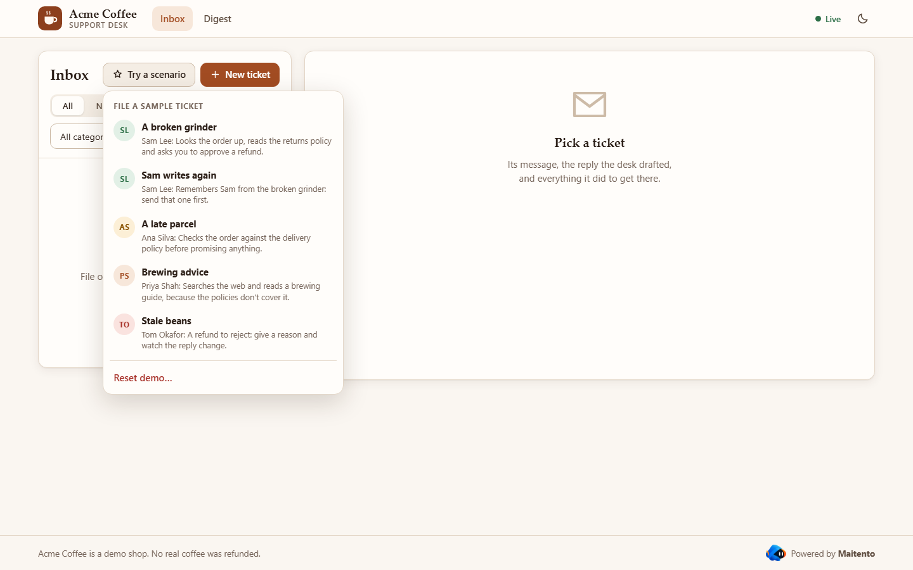
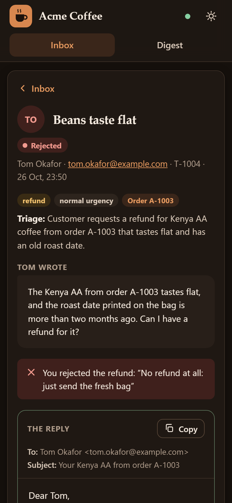
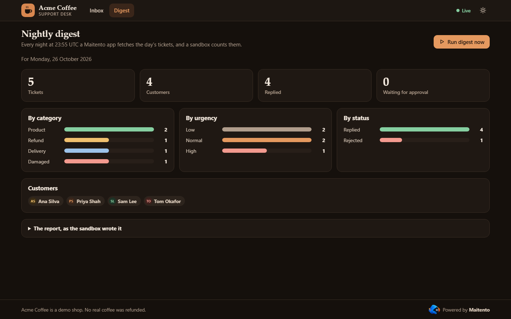
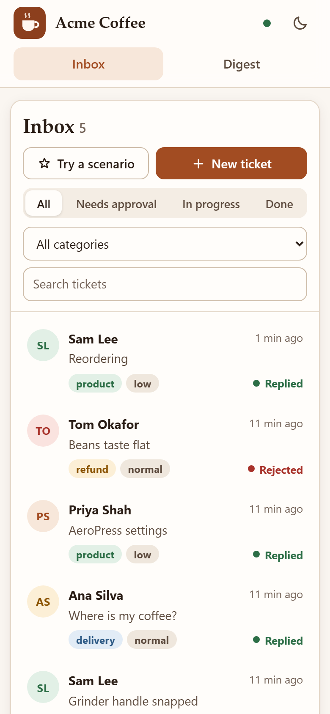

# 23. Support desk

Build the support desk of Acme Coffee, a small online shop. Tickets come in, and Maitento sorts each one, looks up the
order, reads the shop's policies or the web, and drafts the reply. It asks a person before it refunds anything, and it
remembers every customer. Every night it counts the day's tickets in a sandbox. You watch all of it happen in a support
console that updates as the agent works.

Your app is one small server, in TypeScript, Python or C#, with no AI code in it. The intelligence is the Maitento
project, and every piece of it is something an earlier tutorial taught.


- **You'll learn** how the pieces from tutorials 3 to 21 fit together in one app: sorting, tools on your server,
  approvals, webhooks, documents, the web, memory, an app on a schedule and a sandbox. And how to deploy it.
- **New concepts** none. Each piece links back to the tutorial that taught it.
- **Builds on** [3](03-typed-answers.md) typed answers, [9](09-call-your-code.md) your code and secrets,
  [10](10-approvals.md) approvals, [11](11-webhooks.md) webhooks, [13](13-your-documents.md) documents,
  [14](14-web-research.md) the web, [15](15-files-for-agents.md) file systems, [16](16-apps.md) apps,
  [17](17-on-a-schedule.md) schedules, [20](20-memory.md) memory and [21](21-sandboxes.md) sandboxes.
- **Time** about 45 minutes.
- **Cost** well under a cent per ticket on DeepSeek: a reply reads 10,000 to 35,000 tokens, most of them cached, and
  writes under 1,000. The brewing question also makes a metered web search and page read.
- **Needs** a **DeepSeek** model key for the agents and an **OpenAI** model key, because the knowledge base and the
  memory search by meaning. Node.js 22.18, Python 3.10 or the .NET 10 SDK. A public address for your app: a free
  tunnel while you try it, then any container host.

## How it fits together

![Three boxes. The browser shows the support console and talks to your app with JSON; your app sends it every change as live events. Your app serves /api for the page, /maitento/webhook for Maitento, and /shop for the tools, and keeps its tickets in desk.json. Maitento holds triage-ticket, which your app runs for each ticket; draft-reply, the desk agent with a memory per customer, which your app starts, approves or rejects, and whose tools find-order and issue-refund call your app's /shop; and nightly-digest, an app that runs every night at 23:55 UTC, calls list-tickets on your app, and counts the tickets in a capsule. Maitento sends a webhook to your app whenever a reply or the digest changes.](../assets/diagrams/support-desk.svg)

- **Your app calls Maitento** to sort a ticket, start its reply, approve or reject a refund, read what the desk
  remembers about a customer, and run the digest now.
- **Maitento calls your app** for three tools (`find-order`, `issue-refund`, `list-tickets`), with a secret your app
  checks, and with a webhook every time a reply or the digest changes.
- **The browser** only ever talks to your app: a small JSON API, and a stream of Server-Sent Events that carries each
  change as it happens. The API is described in [`web/API.md`](../../examples/23-support-desk/web/API.md).

The page in [`web/`](../../examples/23-support-desk/web/) is plain HTML, CSS and JavaScript, and every server serves it
as it is. The sample orders and tickets are in [`data/`](../../examples/23-support-desk/data/), the shop's policies in
[`knowledge/`](../../examples/23-support-desk/knowledge/).

## 1. Make your app reachable

Maitento calls your app for the tools and the webhook, so it needs a public address. While you try it, start a free
tunnel as in [tutorial 9](09-call-your-code.md), and pick two secrets of your own:

```bash
cloudflared tunnel --url http://localhost:3000
# … Your quick Tunnel has been created! Visit it at: https://quiet-forest-1234.trycloudflare.com

export SHOP_API_KEY="pick-a-long-random-value"
export WEBHOOK_SECRET="another-long-random-value"
export WEBHOOK_URL="https://quiet-forest-1234.trycloudflare.com/maitento/webhook"
```

Put the tunnel's address in the three `shop-*` connectors, in place of `https://YOUR-SERVER.example.com`:

<!-- snippet: examples/23-support-desk/maitento/connectors/open-api/shop-order-get.mtr -->
```hcl title="maitento/connectors/open-api/shop-order-get.mtr"
// The shop API your support desk app serves under /shop. Replace the host with your app's public
// URL in all three shop-* connectors (see tutorial 9 for a free tunnel).
method = "GET"
url = "https://YOUR-SERVER.example.com/shop/orders/{orderId}"
description = "Looks up one order by its id"
auth = "Header"
parameters.path = [
  {
    name = "orderId"
    description = "The order id, for example A-1001"
  }
]
```
<!-- /snippet -->

**Done when** none of the connectors in `maitento/connectors/open-api/` say `YOUR-SERVER` any more.

## 2. Set up Maitento

The setup script does, in order, what tutorials 9 to 21 did one at a time:

1. stores `SHOP_API_KEY` as the `shop-api-key` secret, which the tools send to your app (tutorial 9);
2. creates the `support-desk` file system and puts the digest's script in it (tutorials 15 and 21);
3. uploads the policies into the `shop-policies` knowledge base, and makes a temporary one for web pages
   (tutorials 13 and 14);
4. deploys the project;
5. registers your webhook for interaction runs and app runs (tutorial 11);
6. schedules the nightly digest at 23:55 UTC (tutorial 17), and waits for the policies to be searchable.

<!-- tabs -->
<!-- snippet: examples/23-support-desk/typescript/setup.ts -->
```ts title="TypeScript"
import { readdir, readFile } from "node:fs/promises";
import { Maitento, type CreateAutomatedActionRequest } from "@maitento/sdk";

// The key your app's API checks, and where Maitento sends run updates: your app's public URL + /maitento/webhook.
const apiKey = process.env.SHOP_API_KEY;
const webhookUrl = process.env.WEBHOOK_URL;
const webhookSecret = process.env.WEBHOOK_SECRET;
if (!apiKey || !webhookUrl || !webhookSecret) {
  throw new Error("Set SHOP_API_KEY, WEBHOOK_URL and WEBHOOK_SECRET first.");
}

const mt = new Maitento();
const namespace = process.env.MAITENTO_NAMESPACE ?? "tutorials";

// 1. The key the tools send to your app, kept as a secret (tutorial 9).
const secret = await mt.secrets.findByName("shop-api-key");
if (secret) await mt.secrets.update(secret.id, { name: "shop-api-key", value: apiKey });
else await mt.secrets.create({ name: "shop-api-key", value: apiKey });

// 2. The desk's file system, with the report script in it. The capsule mounts it, so it must exist
//    before the deploy (tutorials 15 and 21).
if (!(await mt.namespaces.find(namespace))) await mt.namespaces.create({ name: namespace });
if (!(await mt.vfs.findByName("support-desk"))) await mt.vfs.create({ name: "support-desk" });
const script = await readFile("../data/count_tickets.py", "utf8");
await mt.vfs.open("support-desk").writeText("/count_tickets.py", script);

// 3. The shop's policies in a knowledge base (tutorial 13), and a temporary one for web pages (tutorial 14).
const partitions = await mt.partitions.list();
const policies = partitions.find((p) => p.name === "shop-policies" && !p.isTemporary)
  ?? (await mt.partitions.create({ name: "shop-policies" }));
for (const file of await readdir("../knowledge")) await mt.files.upload(policies.id, `../knowledge/${file}`);
if (!partitions.some((p) => p.name === "web-downloads" && p.isTemporary)) {
  await mt.partitions.create({ name: "web-downloads", isTemporary: true, fileLifetimeHours: 24 });
}

// 4. The agents, tools, app and capsule.
await mt.deploy("../maitento");

// 5. Maitento calls your app whenever an interaction run (a reply) or an app run (the digest) changes (tutorial 11).
const hooks = await mt.webhooks.list();
for (const type of ["InteractionProcess", "AppProcess"] as const) {
  if (!hooks.some((hook) => hook.url === webhookUrl && hook.type === type)) {
    await mt.webhooks.create({ type, url: webhookUrl, secret: webhookSecret });
  }
}

// 6. The nightly digest runs at 23:55 UTC (tutorial 17). An automation runs the app version it names,
//    so running setup again points it at the version just deployed.
const app = await mt.apps.getByName("nightly-digest");
const latest = Math.max(...app.versions.map((v) => v.version));
const digest: CreateAutomatedActionRequest = {
  name: "nightly-digest",
  description: "Counts the day's support tickets",
  actions: [{
    name: "write-digest",
    config: {
      $type: "app",
      version: { id: app.id, version: latest },
      inputs: [{ name: "namespaceName", value: namespace }],
    },
  }],
};
const existing = await mt.automations.findByName("nightly-digest");
const automation = existing ? await mt.automations.update(existing.id, digest) : await mt.automations.create(digest);
if (!automation.schedules.some((s) => s.name === "every-night")) {
  await mt.automations.addSchedule(automation.id, { name: "every-night", minute: "55", hour: "23" });
}

// The policies take a few seconds to index. Wait until the agent can search them.
for (;;) {
  const files = [];
  for await (const file of mt.partitions.files(policies.id)) files.push(file);
  if (files.length > 0 && files.every((f) => f.isVectorGenerated)) break;
  await new Promise((resolve) => setTimeout(resolve, 2000));
}
console.log("The support desk is set up. Start the app with: node server.ts");
```
<!-- /snippet -->
<!-- snippet: examples/23-support-desk/python/setup.py -->
```python title="Python"
import os
import sys
import time
from pathlib import Path

from maitento import Maitento

# The key your app's API checks, and where Maitento sends run updates: your app's public URL + /maitento/webhook.
api_key = os.environ.get("SHOP_API_KEY")
webhook_url = os.environ.get("WEBHOOK_URL")
webhook_secret = os.environ.get("WEBHOOK_SECRET")
if not api_key or not webhook_url or not webhook_secret:
    sys.exit("Set SHOP_API_KEY, WEBHOOK_URL and WEBHOOK_SECRET first.")

mt = Maitento()
namespace = os.environ.get("MAITENTO_NAMESPACE", "tutorials")

# 1. The key the tools send to your app, kept as a secret (tutorial 9).
secret = mt.secrets.find_by_name("shop-api-key")
if secret:
    mt.secrets.update(secret.id, name="shop-api-key", value=api_key)
else:
    mt.secrets.create("shop-api-key", api_key)

# 2. The desk's file system, with the report script in it. The capsule mounts it, so it must exist
#    before the deploy (tutorials 15 and 21).
if not mt.namespaces.find(namespace):
    mt.namespaces.create(namespace)
if not mt.vfs.find_by_name("support-desk"):
    mt.vfs.create("support-desk")
script = Path("../data/count_tickets.py").read_text(encoding="utf-8")
mt.vfs.open("support-desk").write_text("/count_tickets.py", script)

# 3. The shop's policies in a knowledge base (tutorial 13), and a temporary one for web pages (tutorial 14).
partitions = mt.partitions.list()
policies = next((p for p in partitions if p.name == "shop-policies" and not p.is_temporary), None)
if policies is None:
    policies = mt.partitions.create("shop-policies")
for file in sorted(Path("../knowledge").iterdir()):
    mt.files.upload(policies.id, file)
if not any(p.name == "web-downloads" and p.is_temporary for p in partitions):
    mt.partitions.create("web-downloads", is_temporary=True, file_lifetime_hours=24)

# 4. The agents, tools, app and capsule.
mt.deploy("../maitento")

# 5. Maitento calls your app whenever an interaction run (a reply) or an app run (the digest) changes (tutorial 11).
hooks = mt.webhooks.list()
for kind in ("InteractionProcess", "AppProcess"):
    if not any(hook.url == webhook_url and hook.type == kind for hook in hooks):
        mt.webhooks.create(type=kind, url=webhook_url, secret=webhook_secret)

# 6. The nightly digest runs at 23:55 UTC (tutorial 17). An automation runs the app version it names,
#    so running setup again points it at the version just deployed.
app = mt.apps.get_by_name("nightly-digest")
latest = max(v.version for v in app.versions)
digest = {
    "name": "nightly-digest",
    "description": "Counts the day's support tickets",
    "actions": [{
        "name": "write-digest",
        "config": {
            "$type": "app",
            "version": {"id": app.id, "version": latest},
            "inputs": [{"name": "namespaceName", "value": namespace}],
        },
    }],
}
existing = mt.automations.find_by_name("nightly-digest")
automation = mt.automations.update(existing.id, digest) if existing else mt.automations.create(digest)
if not any(s.name == "every-night" for s in automation.schedules):
    mt.automations.add_schedule(automation.id, name="every-night", minute="55", hour="23")

# The policies take a few seconds to index. Wait until the agent can search them.
while True:
    files = list(mt.partitions.files(policies.id))
    if files and all(f.is_vector_generated for f in files):
        break
    time.sleep(2)
print("The support desk is set up. Start the app with: uvicorn server:app --port 3000")
```
<!-- /snippet -->
<!-- snippet: examples/23-support-desk/csharp/setup.cs -->
```csharp title="C#"
#:package Maitento.Sdk@26.10.0

using Maitento.Entities.AutomatedActions;
using Maitento.Entities.AutomatedActions.ProcessStartConfigs;
using Maitento.Entities.Core;
using Maitento.Entities.Database;
using Maitento.Entities.WebHooks;
using Maitento.Sdk;

// The key your app's API checks, and where Maitento sends run updates: your app's public URL + /maitento/webhook.
var apiKey = Environment.GetEnvironmentVariable("SHOP_API_KEY");
var webhookUrl = Environment.GetEnvironmentVariable("WEBHOOK_URL");
var webhookSecret = Environment.GetEnvironmentVariable("WEBHOOK_SECRET");
if (string.IsNullOrEmpty(apiKey) || string.IsNullOrEmpty(webhookUrl) || string.IsNullOrEmpty(webhookSecret))
    throw new InvalidOperationException("Set SHOP_API_KEY, WEBHOOK_URL and WEBHOOK_SECRET first.");

await using var mt = MaitentoClient.CreateFromEnvironment();
var ns = mt.DefaultNamespace ?? "tutorials";

// 1. The key the tools send to your app, kept as a secret (tutorial 9).
var secret = await mt.Secrets.GetByNameAsync("shop-api-key");
if (secret != null) await mt.Secrets.UpdateAsync(secret.Id, "shop-api-key", apiKey);
else await mt.Secrets.CreateAsync("shop-api-key", apiKey);

// 2. The desk's file system, with the report script in it. The capsule mounts it, so it must exist
//    before the deploy (tutorials 15 and 21).
if (await mt.Namespaces.GetByNameAsync(ns) == null) await mt.Namespaces.CreateAsync(ns);
var deskFiles = await mt.VirtualFileSystems.GetByNameAsync(ns, "support-desk")
    ?? await mt.VirtualFileSystems.CreateAsync(ns, "support-desk");
await mt.VirtualFileSystems.WriteTextById(deskFiles.Id, "/count_tickets.py", await File.ReadAllTextAsync("../data/count_tickets.py"));

// 3. The shop's policies in a knowledge base (tutorial 13), and a temporary one for web pages (tutorial 14).
var partitions = await mt.Partitions.GetAllAsync();
var policies = partitions.FirstOrDefault(p => p.Name == "shop-policies" && !p.IsTemporary)
    ?? await mt.Partitions.CreateAsync("shop-policies");
foreach (var file in Directory.GetFiles("../knowledge"))
    await mt.Files.IngestFileAsync(policies.Id, await File.ReadAllBytesAsync(file), Path.GetFileName(file), "text/markdown");
if (!partitions.Any(p => p.Name == "web-downloads" && p.IsTemporary))
    await mt.Partitions.CreateAsync("web-downloads", isTemporary: true, fileLifetimeHours: 24);

// 4. The agents, tools, app and capsule.
await mt.DeployAsync("../maitento", ns);

// 5. Maitento calls your app whenever an interaction run (a reply) or an app run (the digest) changes (tutorial 11).
var hooks = await mt.WebHooks.GetAllAsync();
foreach (var type in new[] { WebHookType.InteractionProcess, WebHookType.AppProcess })
{
    if (!hooks.Any(hook => hook.Url == webhookUrl && hook.Type == type))
        await mt.WebHooks.CreateAsync(type, webhookUrl, webhookSecret, []);
}

// 6. The nightly digest runs at 23:55 UTC (tutorial 17). An automation runs the app version it names,
//    so running setup again points it at the version just deployed.
var app = (await mt.Apps.GetByNameAsync(ns, "nightly-digest"))!;
var latest = app.Versions.Max(v => v.Version);
AutomatedActionItem[] actions =
[
    new AutomatedActionItem
    {
        Name = "write-digest",
        Config = new AppProcessStartConfig
        {
            Version = new VersionReference(app.Id, latest),
            Inputs = [new NameValuePair("namespaceName", ns)],
        },
    },
];
var existing = await mt.AutomatedActions.GetByNameAsync(ns, "nightly-digest");
var automation = existing != null
    ? await mt.AutomatedActions.UpdateAsync(existing.Id, "nightly-digest", "Counts the day's support tickets", actions)
    : await mt.AutomatedActions.CreateAsync(ns, "nightly-digest", "Counts the day's support tickets", actions);
if (!automation.Schedules.Any(s => s.Name == "every-night"))
{
    await mt.AutomatedActions.AddScheduleAsync(automation.Id,
        new CronSchedule { Name = "every-night", Minute = "55", Hour = "23" });
}

// The policies take a few seconds to index. Wait until the agent can search them.
while (true)
{
    var files = await mt.Partitions.GetFilesAsync(policies.Id);
    if (files != null && files.Items.Length > 0 && files.Items.All(f => f.IsVectorGenerated)) break;
    await Task.Delay(2000);
}
Console.WriteLine("The support desk is set up. Start the app with: dotnet run server.cs");
```
<!-- /snippet -->
<!-- /tabs -->

<!-- tabs -->
```bash title="TypeScript"
cd examples/23-support-desk/typescript
npm install
node setup.ts
```
```bash title="Python"
cd examples/23-support-desk/python
pip install -r requirements.txt
python setup.py
```
```bash title="C#"
cd examples/23-support-desk/csharp
dotnet run setup.cs
```
<!-- /tabs -->

**Done when** it prints `The support desk is set up.` It takes a minute or so: most of it is the policies being
indexed.

## 3. Open the desk

Start the server with the same environment variables, and open `http://localhost:3000`:

<!-- tabs -->
```bash title="TypeScript"
node server.ts
```
```bash title="Python"
uvicorn server:app --port 3000
```
```bash title="C#"
dotnet run server.cs
```
<!-- /tabs -->

The inbox is empty. **Try a scenario** files realistic tickets in one click, and **New ticket** lets you write your own
as a customer. **Reset demo** at the bottom of the menu deletes the tickets and puts the orders back.



**Done when** the top bar says **Live**: the page is connected to your server's event stream.

## 4. A refund that waits for you

Choose **A broken grinder**. Sam Lee writes that the hand grinder from order A-1001 snapped. Within a few seconds the
ticket is sorted, and soon after it waits for you, as in the picture at the top of this page.

**Sorting.** Triage is a one-shot interaction with a response schema, as in [tutorial 3](03-typed-answers.md), so the
app reads its answer straight into the ticket:

<!-- snippet: examples/23-support-desk/maitento/json/ticket-triage.json -->
```json title="maitento/json/ticket-triage.json"
{
  "type": "object",
  "properties": {
    "category": { "type": "string", "enum": ["damaged", "delivery", "refund", "product", "other"] },
    "urgency": { "type": "string", "enum": ["low", "normal", "high"] },
    "orderId": { "type": ["string", "null"] },
    "summary": { "type": "string", "description": "The ticket in one short sentence" }
  },
  "required": ["category", "urgency", "orderId", "summary"],
  "additionalProperties": false
}
```
<!-- /snippet -->

**Starting the reply.** Triage takes a few seconds, so the app waits for it. Drafting the reply can take a minute and
may stop for an approval, so the app only *starts* it, and the webhook says how it goes (tutorial 11). The server
answers the browser at once and does this work afterwards:

<!-- tabs -->
<!-- snippet: examples/23-support-desk/typescript/server.ts#ticket -->
```ts title="TypeScript"
app.post("/api/tickets", (req, res) => {
  const { customer, email, subject, message } = req.body as Record<string, string | undefined>;
  if (!customer?.trim() || !email?.includes("@") || !message?.trim()) {
    res.status(400).json({ error: "A ticket needs a customer, an email address and a message." });
    return;
  }
  const ticket: Ticket = {
    id: `T-${1001 + desk.tickets.length}`, customer: customer.trim(), email: email.trim(), subject: subject?.trim() ?? "",
    message: message.trim(), created: new Date().toISOString(), status: "new", triage: null, runId: null,
    loomId: null, updated: null, approval: null, decision: null, steps: [], reply: null, error: null,
  };
  desk.tickets.unshift(ticket);
  changed(ticket);
  res.status(201).json(ticket);
  void work(ticket); // the browser hears how it goes over /api/events
});

async function work(ticket: Ticket) {
  try {
    // Triage takes a few seconds and answers in JSON, so wait for it (tutorial 3).
    const triage = await mt.interactions.run("triage-ticket", { inputs: { message: ticket.message } });
    ticket.triage = JSON.parse(triage.output!) as NonNullable<Ticket["triage"]>;
    ticket.status = "triaged";
    changed(ticket);

    // The reply can take a minute, and may wait for a person to approve a refund.
    // Start it and move on: the webhook says when it changes (tutorial 11).
    const { category, urgency, orderId } = ticket.triage;
    const { policies, webPages } = await findKnowledgeBases();
    const run = await mt.interactions.start("draft-reply", {
      inputs: { customer: ticket.customer, email: ticket.email, message: ticket.message, category, urgency, orderId,
        policiesId: policies },
      webDownloadPartitionId: webPages, // where web pages the agent reads are kept (tutorial 14)
    });
    ticket.runId = run.id;
    ticket.loomId = run.looms[0]?.loom ?? null; // this customer's memory (tutorial 20)
    ticket.status = "drafting";
    changed(ticket);
  } catch (error) {
    ticket.status = "failed";
    ticket.error = errorText(error);
    changed(ticket);
  }
}
```
<!-- /snippet -->
<!-- snippet: examples/23-support-desk/python/server.py#ticket -->
```python title="Python"
class NewTicket(BaseModel):
    customer: str = ""
    email: str = ""
    subject: str = ""
    message: str = ""


@app.post("/api/tickets", status_code=201, response_model=None)
async def new_ticket(body: NewTicket, background: BackgroundTasks) -> Ticket | JSONResponse:
    if not body.customer.strip() or "@" not in body.email or not body.message.strip():
        return error("A ticket needs a customer, an email address and a message.", 400)
    ticket: Ticket = {
        "id": f"T-{1001 + len(desk['tickets'])}", "customer": body.customer.strip(), "email": body.email.strip(),
        "subject": body.subject.strip(), "message": body.message.strip(),
        "created": datetime.now(timezone.utc).isoformat(), "status": "new", "triage": None, "runId": None,
        "loomId": None, "updated": None, "approval": None, "decision": None, "steps": [], "reply": None, "error": None,
    }
    desk["tickets"].insert(0, ticket)
    changed(ticket)
    background.add_task(work, ticket)  # the browser hears how it goes over /api/events
    return ticket


async def work(ticket: Ticket) -> None:
    try:
        # Triage takes a few seconds and answers in JSON, so wait for it (tutorial 3).
        triage = await mt.interactions.run("triage-ticket", inputs={"message": ticket["message"]})
        ticket["triage"] = json.loads(triage.output or "{}")
        ticket["status"] = "triaged"
        changed(ticket)

        # The reply can take a minute, and may wait for a person to approve a refund.
        # Start it and move on: the webhook says when it changes (tutorial 11).
        kb = await find_knowledge_bases()
        inputs = {"customer": ticket["customer"], "email": ticket["email"], "message": ticket["message"],
                  "category": ticket["triage"]["category"], "urgency": ticket["triage"]["urgency"],
                  "policiesId": kb["shop-policies"]}
        if ticket["triage"]["orderId"]:
            inputs["orderId"] = ticket["triage"]["orderId"]
        run = await mt.interactions.start(
            "draft-reply",
            inputs=inputs,
            web_download_partition_id=kb["web-downloads"],  # where web pages the agent reads are kept (tutorial 14)
        )
        ticket["runId"] = run.id
        ticket["loomId"] = run.looms[0].loom if run.looms else None  # this customer's memory (tutorial 20)
        ticket["status"] = "drafting"
        changed(ticket)
    except Exception as e:
        ticket["status"] = "failed"
        ticket["error"] = str(e)
        changed(ticket)
```
<!-- /snippet -->
<!-- snippet: examples/23-support-desk/csharp/server.cs#ticket -->
```csharp title="C#"
app.MapPost("/api/tickets", (NewTicket body) =>
{
    if (string.IsNullOrWhiteSpace(body.Customer) || body.Email?.Contains('@') != true || string.IsNullOrWhiteSpace(body.Message))
        return Error("A ticket needs a customer, an email address and a message.", 400);
    Ticket ticket;
    lock (gate)
    {
        ticket = new Ticket
        {
            Id = $"T-{1001 + desk.Tickets.Count}", Customer = body.Customer.Trim(), Email = body.Email.Trim(),
            Subject = body.Subject?.Trim() ?? "", Message = body.Message.Trim(), Created = DateTime.UtcNow.ToString("O"),
        };
        desk.Tickets.Insert(0, ticket);
    }
    Update(ticket, _ => { });
    _ = Task.Run(() => Work(ticket)); // the browser hears how it goes over /api/events
    return Results.Created($"/api/tickets/{ticket.Id}", ticket);
});

async Task Work(Ticket ticket)
{
    try
    {
        // Triage takes a few seconds and answers in JSON, so wait for it (tutorial 3).
        var triageRun = await mt.Interactions.RunAsync("triage-ticket",
            new Dictionary<string, string> { ["message"] = ticket.Message });
        var triage = JsonSerializer.Deserialize<Triage>(triageRun.Output!, json)!;
        Update(ticket, t => { t.Triage = triage; t.Status = "triaged"; });

        // The reply can take a minute, and may wait for a person to approve a refund.
        // Start it and move on: the webhook says when it changes (tutorial 11).
        var (policies, webPages) = await FindKnowledgeBases();
        List<NameValuePair> inputs =
        [
            new("customer", ticket.Customer), new("email", ticket.Email), new("message", ticket.Message),
            new("category", triage.Category), new("urgency", triage.Urgency), new("policiesId", policies.ToString()),
        ];
        if (triage.OrderId != null) inputs.Add(new("orderId", triage.OrderId));
        var run = await mt.InteractionProcesses.StartAsync(ns, "draft-reply", new InteractionProcessStartRequest
        {
            Inputs = [.. inputs],
            WebDownloadPartitionId = webPages, // where web pages the agent reads are kept (tutorial 14)
        });
        Update(ticket, t =>
        {
            t.RunId = run.Id;
            t.LoomId = run.Looms.FirstOrDefault()?.Loom; // this customer's memory (tutorial 20)
            t.Status = "drafting";
        });
    }
    catch (Exception e)
    {
        Update(ticket, t => { t.Status = "failed"; t.Error = e.Message; });
    }
}
```
<!-- /snippet -->
<!-- /tabs -->

The run that `start` returns already names the loom it woke up with: `run.looms`, the customer's memory. The app keeps
its id to show what the desk remembers (step 6).

**The desk agent** is told how to use each tool, and to remember the customer before it finishes:

<!-- snippet: examples/23-support-desk/maitento/prompts/desk-agent.md -->
```md title="maitento/prompts/desk-agent.md"
You are the support desk of Acme Coffee, a small online shop that sells coffee beans and brewing kit.

- Search the shop's policies with search-policies before you promise anything, and follow what they say.
- Look orders up with find-order, by an order id the customer gave you or you remember for them, never by guessing
  one. Never guess what an order holds, what it cost or where it is.
- When the policies say a refund is due, make it with issue-refund. A person approves every refund: tell the customer
  it is done only if the tool call succeeded. If the person rejects it, don't ask for another refund: do what their
  reason says, and tell the customer.
- For coffee questions the policies don't cover, such as brewing advice, search the web and keep to what you find.
- You remember customers, so treat one who has written before as someone you know. Before you finish, use LoomWeave
  to keep what will matter next time: what they bought (the order id and each item), what went wrong, what you did
  about it, and what they told you about themselves. Never weave payment details.

Your answer is the email to send to the customer, and nothing else: warm, short, and signed "Acme Coffee support".
```
<!-- /snippet -->

**Tools on your server.** `find-order`, `issue-refund` and `list-tickets` call your app, with the `shop-api-key` secret
in the `X-Api-Key` header, as in [tutorial 9](09-call-your-code.md). A refund needs a person first, as in
[tutorial 10](10-approvals.md):

<!-- snippet: examples/23-support-desk/maitento/external-operations/open-api/issue-refund.mtr -->
```hcl title="maitento/external-operations/open-api/issue-refund.mtr"
connector = @ref("shop-order-refund")
auth = {
  header = "X-Api-Key"
  secret = @ref("shop-api-key")
}
guidance = "Refunds an order. Refund only what the policies allow, and never more than was paid for the item."
// A person approves every refund in the support desk app before Maitento calls it.
requiresApproval = true
```
<!-- /snippet -->

Your app checks the key on everything under `/shop`, then looks orders up, refunds them, or lists a day's tickets:

<!-- tabs -->
<!-- snippet: examples/23-support-desk/typescript/server.ts#shop -->
```ts title="TypeScript"
app.use("/shop", (req, res, next) => {
  if (!constantTimeEqual(req.get("X-Api-Key") ?? "", apiKey)) {
    res.status(401).json({ error: "Unauthorised" });
    return;
  }
  next();
});

app.get("/shop/orders/:orderId", (req, res) => {
  const order = desk.orders.find((o) => o.id === req.params.orderId);
  if (order) res.json(order);
  else res.status(404).json({ error: `There is no order ${req.params.orderId}` });
});

app.post("/shop/orders/:orderId/refund", (req, res) => {
  const order = desk.orders.find((o) => o.id === req.params.orderId);
  if (!order) {
    res.status(404).json({ error: `There is no order ${req.params.orderId}` });
    return;
  }
  const { amount, reason } = req.body as { amount: number; reason: string };
  const refundable = order.items.reduce((sum, item) => sum + item.price, 0) - order.refunded;
  if (!(amount > 0 && amount <= refundable)) {
    res.status(400).json({ error: `You can refund between 0.01 and ${refundable.toFixed(2)} ${order.currency}` });
    return;
  }
  order.refunded += amount;
  save();
  console.log(`Refunded ${amount} ${order.currency} on ${order.id}: ${reason}`);
  res.json({ orderId: order.id, refunded: amount, totalRefunded: order.refunded, currency: order.currency });
});

// The nightly-digest app asks for one day's tickets.
app.get("/shop/tickets/:date", (req, res) => {
  const day = desk.tickets.filter((t) => t.created.startsWith(req.params.date));
  res.json({
    date: req.params.date,
    tickets: day.map((t) => ({ id: t.id, customer: t.customer, category: t.triage?.category ?? null,
      urgency: t.triage?.urgency ?? null, status: t.status })),
  });
});
```
<!-- /snippet -->
<!-- snippet: examples/23-support-desk/python/server.py#shop -->
```python title="Python"
@app.middleware("http")
async def check_api_key(request: Request, call_next):
    if request.url.path.startswith("/shop/") and not hmac.compare_digest(request.headers.get("X-Api-Key", ""), API_KEY):
        return error("Unauthorised", 401)
    return await call_next(request)


@app.get("/shop/orders/{order_id}", response_model=None)
async def get_order(order_id: str) -> dict[str, Any] | JSONResponse:
    order = next((o for o in desk["orders"] if o["id"] == order_id), None)
    return order if order else error(f"There is no order {order_id}", 404)


class Refund(BaseModel):
    amount: float
    reason: str


@app.post("/shop/orders/{order_id}/refund", response_model=None)
async def refund_order(order_id: str, refund: Refund) -> dict[str, Any] | JSONResponse:
    order = next((o for o in desk["orders"] if o["id"] == order_id), None)
    if order is None:
        return error(f"There is no order {order_id}", 404)
    refundable = sum(item["price"] for item in order["items"]) - order["refunded"]
    if not 0 < refund.amount <= refundable:
        return error(f"You can refund between 0.01 and {refundable:.2f} {order['currency']}", 400)
    order["refunded"] += refund.amount
    save()
    print(f"Refunded {refund.amount} {order['currency']} on {order_id}: {refund.reason}")
    return {"orderId": order_id, "refunded": refund.amount, "totalRefunded": order["refunded"],
            "currency": order["currency"]}


# The nightly-digest app asks for one day's tickets.
@app.get("/shop/tickets/{date}")
async def day_of_tickets(date: str) -> dict[str, Any]:
    day = [t for t in desk["tickets"] if t["created"].startswith(date)]
    return {"date": date, "tickets": [
        {"id": t["id"], "customer": t["customer"], "category": (t["triage"] or {}).get("category"),
         "urgency": (t["triage"] or {}).get("urgency"), "status": t["status"]} for t in day]}
```
<!-- /snippet -->
<!-- snippet: examples/23-support-desk/csharp/server.cs#shop -->
```csharp title="C#"
var shop = app.MapGroup("/shop").AddEndpointFilter(async (context, next) =>
{
    var sent = Encoding.UTF8.GetBytes(context.HttpContext.Request.Headers["X-Api-Key"].ToString());
    return CryptographicOperations.FixedTimeEquals(sent, Encoding.UTF8.GetBytes(apiKey))
        ? await next(context)
        : Error("Unauthorised", 401);
});

shop.MapGet("/orders/{orderId}", (string orderId) =>
{
    lock (gate)
    {
        var order = desk.Orders.Find(o => o.Id == orderId);
        return order != null ? Results.Ok(order) : Error($"There is no order {orderId}", 404);
    }
});

shop.MapPost("/orders/{orderId}/refund", (string orderId, RefundRequest refund) =>
{
    lock (gate)
    {
        var order = desk.Orders.Find(o => o.Id == orderId);
        if (order == null) return Error($"There is no order {orderId}", 404);
        var refundable = order.Items.Sum(item => item.Price) - order.Refunded;
        if (refund.Amount <= 0 || refund.Amount > refundable)
            return Error($"You can refund between 0.01 and {refundable:0.00} {order.Currency}", 400);
        order.Refunded += refund.Amount;
        Save();
        Console.WriteLine($"Refunded {refund.Amount} {order.Currency} on {orderId}: {refund.Reason}");
        return Results.Ok(new { orderId, refunded = refund.Amount, totalRefunded = order.Refunded, currency = order.Currency });
    }
});

// The nightly-digest app asks for one day's tickets.
shop.MapGet("/tickets/{date}", (string date) =>
{
    lock (gate)
    {
        var tickets = desk.Tickets.Where(t => t.Created.StartsWith(date))
            .Select(t => new { t.Id, t.Customer, category = t.Triage?.Category, urgency = t.Triage?.Urgency, t.Status })
            .ToList();
        return Results.Ok(new { date, tickets });
    }
});
```
<!-- /snippet -->
<!-- /tabs -->

**Maitento says what changed.** Every time the run changes, Maitento sends its whole state to your webhook, as in
[tutorial 11](11-webhooks.md). The SDK's `verifyWebhook` checks the delivery's signature against the raw body (which
is why the app keeps that one route's body raw), and `parseWebhook` reads the run. Deliveries can repeat and arrive
out of order, so the app keeps only the newest state of each run:

<!-- tabs -->
<!-- snippet: examples/23-support-desk/typescript/server.ts#webhook -->
```ts title="TypeScript"
app.put("/maitento/webhook", async (req, res) => {
  const body = req.body as Buffer; // the raw body, which the signature covers
  if (!(await verifyWebhook(req.headers, body, webhookSecret))) {
    res.sendStatus(401);
    return;
  }
  const delivery = parseWebhook(req.headers, body);
  res.sendStatus(204); // answer at once, and do the work after
  try {
    if (delivery.type === "InteractionProcess") await runChanged(delivery.entity);
    if (delivery.type === "AppProcess") digestChanged(delivery.entity);
  } catch (error) {
    console.error(`Webhook for ${delivery.id}: ${errorText(error)}`);
  }
});

async function runChanged(run: InteractionProcess) {
  // Webhooks come for every run in the tenant: keep only this desk's. Deliveries can repeat and arrive out of
  // order, so keep only the newest state of each run.
  const ticket = desk.tickets.find((t) => t.runId === run.id);
  const updated = run.dateUpdated.toISOString();
  const isOld = () => ticket?.updated != null && updated <= ticket.updated;
  if (!ticket || isOld()) return;
  const steps = await toolCalls(run, ticket.steps);
  if (isOld()) return; // a newer delivery got here while the tool results were being read

  const approval = run.status === "PendingApproval" ? run.pendingApproval : null;
  ticket.updated = updated;
  ticket.steps = steps;
  ticket.approval = approval && { id: approval.id, tool: approval.functionName, arguments: approval.argumentsJson };
  ticket.reply = run.output;
  ticket.error = run.failureDetails;
  if (run.status === "PendingApproval") ticket.status = "approval";
  else if (run.status === "Finished") ticket.status = ticket.decision?.approved === false ? "rejected" : "replied";
  else if (run.status === "Error" || run.status === "Killed") ticket.status = "failed";
  else ticket.status = "drafting";
  changed(ticket);
}
```
<!-- /snippet -->
<!-- snippet: examples/23-support-desk/python/server.py#webhook -->
```python title="Python"
@app.put("/maitento/webhook")
async def webhook(request: Request, background: BackgroundTasks) -> Response:
    body = await request.body()  # the raw body, which the signature covers
    if not verify_webhook(request.headers, body, WEBHOOK_SECRET):
        return Response(status_code=401)
    delivery = parse_webhook(request.headers, body)
    if delivery.type == "InteractionProcess":
        background.add_task(run_changed, delivery.entity)  # answer at once, and do the work after
    elif delivery.type == "AppProcess":
        digest_changed(delivery.entity)
    return Response(status_code=204)


async def run_changed(run: Any) -> None:
    # Webhooks come for every run in the tenant: keep only this desk's. Deliveries can repeat and arrive out of
    # order, so keep only the newest state of each run.
    ticket = next((t for t in desk["tickets"] if t["runId"] == run.id), None)
    updated = run.date_updated.isoformat(timespec="microseconds")

    def is_old() -> bool:
        return ticket is not None and ticket["updated"] is not None and updated <= ticket["updated"]

    if ticket is None or is_old():
        return
    steps = await tool_calls(run, ticket["steps"])
    if is_old():
        return  # a newer delivery got here while the tool results were being read

    approval = run.pending_approval if run.status == "PendingApproval" else None
    ticket["updated"] = updated
    ticket["steps"] = steps
    ticket["approval"] = approval and {"id": approval.id, "tool": approval.function_name,
                                       "arguments": approval.arguments_json}
    ticket["reply"] = run.output
    ticket["error"] = run.failure_details
    if run.status == "PendingApproval":
        ticket["status"] = "approval"
    elif run.status == "Finished":
        rejected = ticket["decision"] is not None and not ticket["decision"]["approved"]
        ticket["status"] = "rejected" if rejected else "replied"
    elif run.status in ("Error", "Killed"):
        ticket["status"] = "failed"
    else:
        ticket["status"] = "drafting"
    changed(ticket)
```
<!-- /snippet -->
<!-- snippet: examples/23-support-desk/csharp/server.cs#webhook -->
```csharp title="C#"
app.MapPut("/maitento/webhook", async (HttpRequest request) =>
{
    var body = await new StreamReader(request.Body).ReadToEndAsync(); // the raw body, which the signature covers
    if (!MaitentoWebhooks.Verify(name => request.Headers[name], body, webhookSecret))
        return Results.Unauthorized();
    var delivery = MaitentoWebhooks.Parse(name => request.Headers[name], body);
    _ = Task.Run(async () => // answer at once, and do the work after
    {
        try
        {
            if (delivery.Entity is InteractionProcess run) await RunChanged(run);
            if (delivery.Entity is AppProcess appRun) DigestChanged(appRun);
        }
        catch (Exception e)
        {
            Console.Error.WriteLine($"Webhook for {delivery.Id}: {e.Message}");
        }
    });
    return Results.NoContent();
});

async Task RunChanged(InteractionProcess run)
{
    // Webhooks come for every run in the tenant: keep only this desk's. Deliveries can repeat and arrive out of
    // order, so keep only the newest state of each run.
    Ticket? ticket;
    lock (gate) ticket = desk.Tickets.Find(t => t.RunId == run.Id);
    bool IsOld() => ticket?.Updated is { } seen && run.DateUpdated <= seen;
    if (ticket == null || IsOld()) return;
    var steps = await ToolCalls(run, ticket.Steps);

    var approval = run.Status == InteractionProcessStatus.PendingApproval ? run.PendingApproval : null;
    Update(ticket, t =>
    {
        if (IsOld()) return; // a newer delivery got here while the tool results were being read
        t.Updated = run.DateUpdated;
        t.Steps = steps;
        t.Approval = approval == null ? null : new Approval(approval.Id, approval.FunctionName, approval.ArgumentsJson);
        t.Reply = run.Output;
        t.Error = run.FailureDetails;
        t.Status = run.Status switch
        {
            InteractionProcessStatus.PendingApproval => "approval",
            InteractionProcessStatus.Finished => t.Decision?.Approved == false ? "rejected" : "replied",
            InteractionProcessStatus.Error or InteractionProcessStatus.Killed => "failed",
            _ => "drafting",
        };
    });
}
```
<!-- /snippet -->
<!-- /tabs -->

**What the desk did.** The run's state holds every tool call the agent made and its result. The page turns them into
the **What the desk did** list: the order it looked up, the policy passages it read, the web pages it opened, the
refund it asked for, what it chose to remember. A long result is kept outside the run, so the app fetches it once:

<!-- tabs -->
<!-- snippet: examples/23-support-desk/typescript/server.ts#steps -->
```ts title="TypeScript"
async function toolCalls(run: InteractionProcess, known: Step[]): Promise<Step[]> {
  return Promise.all(run.context.toolCall.map(async (call) => {
    const result = run.context.toolResult.find((r) => r.toolCallId === call.toolCallId);
    let output = result?.result ?? known.find((s) => s.id === call.toolCallId)?.output ?? null;
    if (result && output === null) output = (await mt.interactionRuns.toolResult(run.id, result.sequence)).result;
    return {
      id: call.toolCallId, tool: call.functionName, input: call.argumentsJson, output,
      error: result?.isError ?? false, rejection: result?.rejectionReason ?? null,
    };
  }));
}
```
<!-- /snippet -->
<!-- snippet: examples/23-support-desk/python/server.py#steps -->
```python title="Python"
async def tool_calls(run: Any, known: list[dict[str, Any]]) -> list[dict[str, Any]]:
    steps = []
    for call in run.context.tool_call:
        result = next((r for r in run.context.tool_result if r.tool_call_id == call.tool_call_id), None)
        output = result.result if result else None
        if result and output is None:
            output = next((s["output"] for s in known if s["id"] == call.tool_call_id), None)
        if result and output is None:
            output = (await mt.interaction_runs.tool_result(run.id, result.sequence)).result
        steps.append({
            "id": call.tool_call_id, "tool": call.function_name, "input": call.arguments_json, "output": output,
            "error": result.is_error if result else False, "rejection": result.rejection_reason if result else None,
        })
    return steps
```
<!-- /snippet -->
<!-- snippet: examples/23-support-desk/csharp/server.cs#steps -->
```csharp title="C#"
async Task<List<Step>> ToolCalls(InteractionProcess run, List<Step> known)
{
    var steps = new List<Step>();
    foreach (var call in run.Context.ToolCall)
    {
        var result = run.Context.ToolResult.FirstOrDefault(r => r.ToolCallId == call.ToolCallId);
        var output = result?.Result ?? known.Find(s => s.Id == call.ToolCallId)?.Output;
        if (result != null && output == null)
            output = (await mt.InteractionProcesses.GetToolResultAsync(run.Id, result.Sequence))?.Result;
        steps.Add(new Step(call.ToolCallId, call.FunctionName, call.ArgumentsJson, output,
            result?.IsError ?? false, result?.RejectionReason));
    }
    return steps;
}
```
<!-- /snippet -->
<!-- /tabs -->

**You decide.** The card shows what the agent wants to do. **Approve refund** lets Maitento call your app; **Reject…**
asks why, and the agent is told your reason:

<!-- tabs -->
<!-- snippet: examples/23-support-desk/typescript/server.ts#approval -->
```ts title="TypeScript"
app.post("/api/tickets/:id/:decision", async (req, res) => {
  const ticket = desk.tickets.find((t) => t.id === req.params.id);
  const approval = ticket?.approval;
  const approve = req.params.decision === "approve";
  if (!ticket?.runId || !approval || !["approve", "reject"].includes(req.params.decision)) {
    res.status(409).json({ error: "This ticket isn't waiting for an approval." });
    return;
  }
  const reason = (req.body as { reason?: string }).reason?.trim() || "The support team said no.";
  ticket.approval = null; // a second click finds nothing to decide
  ticket.decision = { approved: approve, reason: approve ? null : reason };
  ticket.status = "drafting";
  changed(ticket);
  try {
    if (approve) await mt.interactionRuns.approve(ticket.runId, { approvalId: approval.id });
    else await mt.interactionRuns.reject(ticket.runId, { approvalId: approval.id, reason });
    res.json(ticket);
  } catch (error) {
    Object.assign(ticket, { approval, decision: null, status: "approval" });
    changed(ticket);
    res.status(502).json({ error: errorText(error) });
  }
});
```
<!-- /snippet -->
<!-- snippet: examples/23-support-desk/python/server.py#approval -->
```python title="Python"
class Decision(BaseModel):
    reason: str = ""


@app.post("/api/tickets/{ticket_id}/{decision}", response_model=None)
async def decide(ticket_id: str, decision: str, body: Decision) -> Ticket | JSONResponse:
    ticket = find_ticket(ticket_id)
    approval = ticket["approval"] if ticket else None
    if ticket is None or approval is None or decision not in ("approve", "reject"):
        return error("This ticket isn't waiting for an approval.", 409)
    approve = decision == "approve"
    reason = body.reason.strip() or "The support team said no."
    ticket["approval"] = None  # a second click finds nothing to decide
    ticket["decision"] = {"approved": approve, "reason": None if approve else reason}
    ticket["status"] = "drafting"
    changed(ticket)
    try:
        if approve:
            await mt.interaction_runs.approve(ticket["runId"], approval["id"])
        else:
            await mt.interaction_runs.reject(ticket["runId"], approval["id"], reason)
        return ticket
    except Exception as e:
        ticket.update(approval=approval, decision=None, status="approval")
        changed(ticket)
        return error(e, 502)
```
<!-- /snippet -->
<!-- snippet: examples/23-support-desk/csharp/server.cs#approval -->
```csharp title="C#"
app.MapPost("/api/tickets/{id}/{decision}", async (string id, string decision, DecisionRequest body) =>
{
    Ticket? ticket;
    lock (gate) ticket = desk.Tickets.Find(t => t.Id == id);
    var approval = ticket?.Approval;
    if (ticket?.RunId is not { } runId || approval == null || decision is not ("approve" or "reject"))
        return Error("This ticket isn't waiting for an approval.", 409);
    var approve = decision == "approve";
    var reason = string.IsNullOrWhiteSpace(body.Reason) ? "The support team said no." : body.Reason.Trim();
    // A second click finds nothing to decide.
    Update(ticket, t => { t.Approval = null; t.Decision = new Decision(approve, approve ? null : reason); t.Status = "drafting"; });
    try
    {
        if (approve) await mt.InteractionProcesses.ApproveToolCallAsync(runId, approval.Id);
        else await mt.InteractionProcesses.RejectToolCallAsync(runId, approval.Id, reason);
        return Results.Ok(ticket);
    }
    catch (Exception e)
    {
        Update(ticket, t => { t.Approval = approval; t.Decision = null; t.Status = "approval"; });
        return Error(e.Message, 502);
    }
});
```
<!-- /snippet -->
<!-- /tabs -->

Click **Approve refund**. Your server prints `Refunded 42 GBP on A-1001: Hand grinder handle snapped off on first use…`,
and the reply appears:

```text
Dear Sam,

Thank you for getting in touch, and I am sorry to hear that the handle on your hand grinder snapped the first time you
used it. That is not the experience we want you to have.

I have refunded the full price of the grinder, £42.00, back to your original payment method. The money should appear
within 5 working days. There is no need to send the grinder back to us, though a photo would be helpful if you have
one to hand. …
```

**Done when** the ticket says **Replied**, and **What the desk did** lists the order, the returns policy, the £42 refund
and a memory. The agent refunded the grinder's price, not the whole order: the policy says so.

## 5. Policies and the web

Choose **A late parcel** and **Brewing advice**.

Ana's parcel was sent six working days ago. The agent looks the order up, searches the policies, and tells her it is
late, that the shop is chasing the carrier, and what happens after ten working days. The search tool is tutorial 13's:
the knowledge base's id comes in with each run and is bound straight into the call, so the model only writes the query
and never sees, or mistypes, an id:

<!-- snippet: examples/23-support-desk/maitento/interactions/one-shot/draft-reply.mtr -->
```hcl title="maitento/interactions/one-shot/draft-reply.mtr"
agent = {
  name = "Desk"
  agent = @ref("desk-agent")
}
task = @prompt("draft-reply-task")
inputs.prompts = [
  {
    name = "customer"
    description = "The customer's name"
    required = true
  },
  {
    name = "email"
    description = "The customer's email address: whose memory the agent wakes up with"
    required = true
  },
  {
    name = "message"
    description = "What the customer wrote"
    required = true
  },
  {
    name = "category"
    required = true
  },
  {
    name = "urgency"
    required = true
  },
  {
    name = "orderId"
    required = false
  }
]
functions.openApi = [
  {
    name = "find-order"
    ref = @ref("find-order")
  },
  {
    name = "issue-refund"
    ref = @ref("issue-refund")
  },
  {
    name = "search-policies"
    ref = @ref("search-policies")
  }
]
// The knowledge base id comes in with each run and goes straight into the search (tutorial 13).
inputs.functions.binding = [
  {
    function = @ref("search-policies")
    name = "policiesId"
    target = "partitionId"
    description = "The knowledge base that holds the shop's policies"
    required = true
    type = "request"
  }
]
// One memory per customer, chosen by their email address (tutorial 20).
loom = {
  enabled = true
  scope = "Input"
  scopeInput = "email"
  subjectInputs = [ "customer" ]
  recall = "Suggest"
  weave = "Manual"
}
duration.warn = "00:03:00"
duration.max = "00:05:00"
```
<!-- /snippet -->

Priya asks how to brew a light roast in her AeroPress. The policies don't cover that, so the agent searches the web and
reads a brewing guide, with the built-in web tools from [tutorial 14](14-web-research.md) (`allowWebSearch` and
`allowWebFetch` on the agent). The pages it reads are kept for a day in the temporary `web-downloads` knowledge base.


**Done when** Ana's **What the desk did** shows the delivery policy's late-parcels passage, and Priya's shows a web
search and a page it read.

## 6. A customer it remembers

Now choose **Sam writes again**. Sam asks which beans he bought last time. He doesn't give an order id, or name the
beans:

```text
Hello again! I'd like to order more of the coffee I bought from you last time, but I've lost the email. Which beans
were they?
```

The agent knows. It wakes up with Sam's memory, finds order A-1001 in it, looks the order up to be sure, and answers:

```text
Hello Sam,

Lovely to hear from you again. The coffee on your last order (A-1001) was our Ethiopia Yirgacheffe 250g at £11.50. …
```

The memory is scoped to the `email` input, as Wren's is to `userName` in [tutorial 20](20-memory.md): one loom per
customer, so Sam's history never turns up in Ana's reply. `weave = "Manual"` lets the agent decide what is worth
keeping, and its instructions say what: the order, what went wrong, what it did.

**What the desk remembers about Sam** is read from Maitento, not from the run: the threads of Sam's loom, through the
SDK's looms API:

<!-- tabs -->
<!-- snippet: examples/23-support-desk/typescript/server.ts#memory -->
```ts title="TypeScript"
app.get("/api/tickets/:id/memory", async (req, res) => {
  const loomId = desk.tickets.find((t) => t.id === req.params.id)?.loomId;
  try {
    const threads = loomId ? await mt.looms.threads(loomId, { sort: "Newest", limit: 20 }) : [];
    res.json({ threads: threads.map((t) => ({ content: t.content, kind: t.kind, created: t.dateCreated })) });
  } catch (error) {
    res.status(502).json({ error: errorText(error) });
  }
});
```
<!-- /snippet -->
<!-- snippet: examples/23-support-desk/python/server.py#memory -->
```python title="Python"
@app.get("/api/tickets/{ticket_id}/memory", response_model=None)
async def memory(ticket_id: str) -> dict[str, Any] | JSONResponse:
    ticket = find_ticket(ticket_id)
    loom_id = ticket["loomId"] if ticket else None
    try:
        threads = await mt.looms.threads(loom_id, sort="Newest", limit=20) if loom_id else []
        return {"threads": [{"content": t.content, "kind": t.kind, "created": t.date_created.isoformat()}
                            for t in threads]}
    except Exception as e:
        return error(e, 502)
```
<!-- /snippet -->
<!-- snippet: examples/23-support-desk/csharp/server.cs#memory -->
```csharp title="C#"
app.MapGet("/api/tickets/{id}/memory", async (string id) =>
{
    string? loomId;
    lock (gate) loomId = desk.Tickets.Find(t => t.Id == id)?.LoomId;
    try
    {
        LoomThread[] threads = loomId == null ? [] : await mt.Looms.GetThreadsAsync(Guid.Parse(loomId),
            new ThreadListFilter { Sort = ThreadListOrder.Newest, Limit = 20 });
        return Results.Ok(new { threads = threads.Select(t => new { t.Content, kind = t.Kind.ToString(), created = t.DateCreated }) });
    }
    catch (Exception e)
    {
        return Error(e.Message, 502);
    }
});
```
<!-- /snippet -->
<!-- /tabs -->


**Done when** the reply names the Yirgacheffe, though Sam never did. Send **Sam writes again** before **A broken
grinder** and it can't: there is nothing to remember yet.

## 7. Reject a refund

Choose **Stale beans**. Tom's Kenya AA is more than four weeks past its roast date, so the policy says refund it, and
the agent asks to. Click **Reject…** and say why, for example `We'd rather send Tom a fresh bag than refund it`. The
agent reads your reason and writes the reply around it: a fresh bag, no refund.



**Done when** the ticket says **Rejected**, and the reply offers a fresh bag instead of money.

## 8. The nightly digest

Every night at 23:55 UTC an automation runs the `nightly-digest` app ([tutorials 16](16-apps.md) and
[17](17-on-a-schedule.md)). It calls your app through `list-tickets` (Maitento adds the secret, as it does for the
agent), saves the day's tickets in the `support-desk` file system ([tutorial 15](15-files-for-agents.md)), and starts a
capsule ([tutorial 21](21-sandboxes.md)) that counts them:

<!-- snippet: examples/23-support-desk/maitento/apps/nightly-digest/nightly-digest.mtc -->
```c title="maitento/apps/nightly-digest/nightly-digest.mtc"
// The nightly digest. It fetches the day's tickets from your app, keeps them in the desk's file
// system, and runs a capsule that turns them into a report.
// main's parameter is the app's input: the namespace the file system and the capsule live in.
string main(string namespaceName) {
	string day = DateTimeToString(DateGetUtc(), "yyyy-MM-dd");

	// Call your app through the list-tickets tool: Maitento adds the secret, as it does for the agent's tools.
	jsonObject path = JsonObjectCreate();
	path = JsonObjectSetString(path, "date", day);
	string response = ExtOpInvoke("list-tickets", "", "", path, "");
	jsonArray tickets = JsonObjectGet(StringToJsonObject(response), "tickets");
	PrintLine("Tickets on " + day + ": " + JsonArrayCount(tickets));

	// Save them where the capsule can read them.
	VfsWriteText("support-desk", namespaceName, "/tickets/" + day + ".json", response);

	// The capsule mounts the file system, counts the tickets and writes the report beside them.
	guid capsuleId = CapsuleStart("ticket-report", namespaceName, "[]", "[]", "[]");
	jsonObject capsule = CapsuleAwait(capsuleId);
	if (JsonObjectGet(capsule, "status") != "Finished") {
		throw("The ticket-report capsule ended " + JsonObjectGet(capsule, "status"));
	}

	string report = VfsReadText("support-desk", namespaceName, "/reports/latest.md");
	AppStateSetOutputString("report", report);
	return("Digest written for " + day);
}
```
<!-- /snippet -->

The capsule mounts the file system and runs [`data/count_tickets.py`](../../examples/23-support-desk/data/count_tickets.py),
which writes the report twice: `latest.md` for people, and `latest.json` for the console's charts.

**Run digest now** on the **Digest** tab triggers the automation instead of waiting for tonight. The app run's webhook
tells your app when it has finished, and the page reads the report:

<!-- tabs -->
<!-- snippet: examples/23-support-desk/typescript/server.ts#digest -->
```ts title="TypeScript"
let digest = { running: false, error: null as string | null };
const readReport = async (path: string) => ((await deskFiles.exists(path)) ? deskFiles.readText(path) : null);

app.get("/api/digest", async (_req, res) => {
  try {
    const [report, counts] = await Promise.all([readReport("/reports/latest.md"), readReport("/reports/latest.json")]);
    res.json({ ...digest, report, counts: counts ? JSON.parse(counts) : null });
  } catch (error) {
    res.status(502).json({ error: errorText(error) });
  }
});

app.post("/api/digest", async (_req, res) => {
  try {
    const automation = await mt.automations.getByName("nightly-digest");
    await mt.automations.trigger(automation.id);
    digest = { running: true, error: null };
    send("digest", digest);
    res.status(202).json(digest);
  } catch (error) {
    res.status(502).json({ error: errorText(error) });
  }
});

function digestChanged(run: AppProcess) {
  if (run.triggeredByAutomatedActionName !== "nightly-digest") return;
  const ended = ["Finished", "Error", "Killed"].includes(run.status);
  digest = { running: !ended, error: ended && run.status !== "Finished" ? run.failureDetails ?? run.status : null };
  send("digest", digest);
}
```
<!-- /snippet -->
<!-- snippet: examples/23-support-desk/python/server.py#digest -->
```python title="Python"
digest: dict[str, Any] = {"running": False, "error": None}


async def read_report(path: str) -> Optional[str]:
    return await desk_files.read_text(path) if await desk_files.exists(path) else None


@app.get("/api/digest", response_model=None)
async def get_digest() -> dict[str, Any] | JSONResponse:
    try:
        report, counts = await asyncio.gather(read_report("/reports/latest.md"), read_report("/reports/latest.json"))
        return {**digest, "report": report, "counts": json.loads(counts) if counts else None}
    except Exception as e:
        return error(e, 502)


@app.post("/api/digest", status_code=202, response_model=None)
async def run_digest() -> dict[str, Any] | JSONResponse:
    try:
        automation = await mt.automations.get_by_name("nightly-digest")
        await mt.automations.trigger(automation.id)
        digest.update(running=True, error=None)
        send("digest", digest)
        return digest
    except Exception as e:
        return error(e, 502)


def digest_changed(run: Any) -> None:
    if run.triggered_by_automated_action_name != "nightly-digest":
        return
    ended = run.status in ("Finished", "Error", "Killed")
    digest.update(running=not ended,
                  error=(run.failure_details or run.status) if ended and run.status != "Finished" else None)
    send("digest", digest)
```
<!-- /snippet -->
<!-- snippet: examples/23-support-desk/csharp/server.cs#digest -->
```csharp title="C#"
var digest = new DigestState(false, null);
async Task<string?> ReadReport(string path) =>
    await mt.VirtualFileSystems.ExistsFileByName("support-desk", ns, path)
        ? await mt.VirtualFileSystems.ReadTextByName("support-desk", ns, path)
        : null;

app.MapGet("/api/digest", async () =>
{
    try
    {
        var report = await ReadReport("/reports/latest.md");
        var counts = await ReadReport("/reports/latest.json");
        return Results.Ok(new { digest.Running, digest.Error, report, counts = counts == null ? (JsonElement?)null : JsonDocument.Parse(counts).RootElement });
    }
    catch (Exception e)
    {
        return Error(e.Message, 502);
    }
});

app.MapPost("/api/digest", async () =>
{
    try
    {
        var automation = await mt.AutomatedActions.GetByNameAsync(ns, "nightly-digest")
            ?? throw new InvalidOperationException("The nightly-digest automation is missing: run setup.cs first.");
        await mt.AutomatedActions.TriggerAsync(automation.Id);
        digest = new DigestState(true, null);
        Send("digest", digest);
        return Results.Json(digest, statusCode: 202);
    }
    catch (Exception e)
    {
        return Error(e.Message, 502);
    }
});

void DigestChanged(AppProcess run)
{
    if (run.TriggeredByAutomatedActionName != "nightly-digest") return;
    var ended = run.Status is AppProcessStatus.Finished or AppProcessStatus.Error or AppProcessStatus.Killed;
    digest = new DigestState(!ended, ended && run.Status != AppProcessStatus.Finished ? run.FailureDetails ?? run.Status.ToString() : null);
    Send("digest", digest);
}
```
<!-- /snippet -->
<!-- /tabs -->



To run it from a terminal instead, and print what the app and the capsule wrote:

<!-- tabs -->
<!-- snippet: examples/23-support-desk/typescript/digest.ts -->
```ts title="TypeScript"
import { Maitento } from "@maitento/sdk";

// Run tonight's digest now, instead of waiting for 23:55 UTC.
const mt = new Maitento();
const automation = await mt.automations.getByName("nightly-digest");
const { processId } = await mt.automations.trigger(automation.id);
console.log(`Started the nightly-digest app: ${processId}`);

// Follow the app run until it ends.
const finished = new Set(["Finished", "Error", "Killed"]);
let run = await mt.appRuns.get(processId);
while (!finished.has(run.status)) {
  await new Promise((resolve) => setTimeout(resolve, 2000));
  run = await mt.appRuns.get(processId);
}
for (const line of run.consoleOutputs) console.log(line.text.trimEnd());
if (run.status !== "Finished") throw new Error(`The digest ended ${run.status}: ${run.failureDetails}`);

console.log(`\n${run.returnValue}\n`);
console.log(await mt.vfs.open("support-desk").readText("/reports/latest.md"));
```
<!-- /snippet -->
<!-- snippet: examples/23-support-desk/python/digest.py -->
```python title="Python"
import sys
import time

from maitento import Maitento

# Run tonight's digest now, instead of waiting for 23:55 UTC.
mt = Maitento()
automation = mt.automations.get_by_name("nightly-digest")
process_id = mt.automations.trigger(automation.id).process_id
print(f"Started the nightly-digest app: {process_id}")

# Follow the app run until it ends.
run = mt.app_runs.get(process_id)
while run.status not in ("Finished", "Error", "Killed"):
    time.sleep(2)
    run = mt.app_runs.get(process_id)
for line in run.console_outputs:
    print(line.text.rstrip())
if run.status != "Finished":
    sys.exit(f"The digest ended {run.status}: {run.failure_details}")

print(f"\n{run.return_value}\n")
print(mt.vfs.open("support-desk").read_text("/reports/latest.md"))
```
<!-- /snippet -->
<!-- snippet: examples/23-support-desk/csharp/digest.cs -->
```csharp title="C#"
#:package Maitento.Sdk@26.10.0

using Maitento.Entities.Apps;
using Maitento.Sdk;

// Run tonight's digest now, instead of waiting for 23:55 UTC.
await using var mt = MaitentoClient.CreateFromEnvironment();
var ns = mt.DefaultNamespace ?? "tutorials";
var automation = (await mt.AutomatedActions.GetByNameAsync(ns, "nightly-digest"))!;
var processId = await mt.AutomatedActions.TriggerAsync(automation.Id);
Console.WriteLine($"Started the nightly-digest app: {processId}");

// Follow the app run until it ends.
AppProcessStatus[] finished = [AppProcessStatus.Finished, AppProcessStatus.Error, AppProcessStatus.Killed];
var run = (await mt.Apps.GetProcessAsync(processId))!;
while (!finished.Contains(run.Status))
{
    await Task.Delay(2000);
    run = (await mt.Apps.GetProcessAsync(processId))!;
}
foreach (var line in run.ConsoleOutputs) Console.WriteLine(line.Text.TrimEnd());
if (run.Status != AppProcessStatus.Finished)
    throw new InvalidOperationException($"The digest ended {run.Status}: {run.FailureDetails}");

Console.WriteLine($"\n{run.ReturnValue}\n");
Console.WriteLine(await mt.VirtualFileSystems.ReadTextByName("support-desk", ns, "/reports/latest.md"));
```
<!-- /snippet -->
<!-- /tabs -->

**Done when** the Digest tab shows today's counts, five tickets if you sent the five scenarios.

## 9. Live updates

Nothing on the page refreshes. The browser keeps one request open to `/api/events`, and the server writes an event
down it whenever a ticket or the digest changes: when it is filed, sorted, drafted, waiting, decided or answered.
That's [Server-Sent Events](https://developer.mozilla.org/en-US/docs/Web/API/Server-sent_events), which every browser
reads with `EventSource`:

<!-- tabs -->
<!-- snippet: examples/23-support-desk/typescript/server.ts#events -->
```ts title="TypeScript"
const listeners = new Set<Response>();
const send = (event: string, data: unknown) => {
  for (const listener of listeners) listener.write(`event: ${event}\ndata: ${JSON.stringify(data)}\n\n`);
};
const changed = (ticket: Ticket) => {
  save();
  send("ticket", ticket);
};

app.get("/api/events", (req, res) => {
  res.writeHead(200, { "Content-Type": "text/event-stream", "Cache-Control": "no-cache", Connection: "keep-alive" });
  res.write(": connected\n\n");
  listeners.add(res);
  req.on("close", () => listeners.delete(res));
});
setInterval(() => send("ping", {}), 15_000); // keeps proxies from closing a quiet stream
```
<!-- /snippet -->
<!-- snippet: examples/23-support-desk/python/server.py#events -->
```python title="Python"
listeners: set[asyncio.Queue[str]] = set()


def send(event: str, data: Any) -> None:
    for queue in listeners:
        queue.put_nowait(f"event: {event}\ndata: {json.dumps(data)}\n\n")


def changed(ticket: Ticket) -> None:
    save()
    send("ticket", ticket)


@app.get("/api/events")
async def events() -> StreamingResponse:
    async def stream():
        queue: asyncio.Queue[str] = asyncio.Queue()
        listeners.add(queue)
        try:
            yield ": connected\n\n"
            while True:
                try:
                    yield await asyncio.wait_for(queue.get(), timeout=15)
                except asyncio.TimeoutError:
                    yield "event: ping\ndata: {}\n\n"  # keeps proxies from closing a quiet stream
        finally:
            listeners.discard(queue)

    return StreamingResponse(stream(), media_type="text/event-stream", headers={"Cache-Control": "no-cache"})
```
<!-- /snippet -->
<!-- snippet: examples/23-support-desk/csharp/server.cs#events -->
```csharp title="C#"
var listeners = new ConcurrentDictionary<Channel<SseItem<string>>, bool>();
void Send(string type, object data)
{
    var item = new SseItem<string>(JsonSerializer.Serialize(data, JsonSerializerOptions.Web), type);
    foreach (var listener in listeners.Keys) listener.Writer.TryWrite(item);
}
void Update(Ticket ticket, Action<Ticket> change)
{
    lock (gate)
    {
        change(ticket);
        Save();
        Send("ticket", ticket);
    }
}

app.MapGet("/api/events", (CancellationToken closed) =>
{
    var listener = Channel.CreateUnbounded<SseItem<string>>();
    listener.Writer.TryWrite(new SseItem<string>("{}", "ping")); // the stream starts at its first event
    listeners[listener] = true;
    closed.Register(() => listeners.TryRemove(listener, out _));
    return TypedResults.ServerSentEvents(listener.Reader.ReadAllAsync(closed));
});
using var keepAlive = new Timer(_ => Send("ping", new { }), null, 15_000, 15_000); // keeps proxies from closing a quiet stream
```
<!-- /snippet -->
<!-- /tabs -->

So a change travels Maitento → webhook → your app → event → page, and the page never asks Maitento anything itself.
Your API key stays on your server.



**Done when** you file a ticket in one browser window and watch it move through **New**, **Triaged**, **Drafting** and
**Replied** in another.

## Deploy it

The desk runs anywhere that runs a container and gives it a public HTTPS address: Maitento has to reach it for the
tools and the webhook. Build the image from the example's folder, so the page and the data go in with the server:

<!-- snippet: examples/23-support-desk/typescript/Dockerfile -->
```dockerfile title="typescript/Dockerfile"
# The TypeScript support desk in a container. Build it from the example's folder, so web/ and data/ come along:
#
#   docker build -f typescript/Dockerfile -t acme-support-desk .
#   docker run -p 3000:3000 -v desk-state:/app/state \
#     -e MAITENTO_API_KEY -e MAITENTO_NAMESPACE -e SHOP_API_KEY -e WEBHOOK_SECRET acme-support-desk
#
# The image also holds setup.ts and the Maitento project, so `docker run … acme-support-desk node setup.ts` sets up
# Maitento from the same image (it needs WEBHOOK_URL as well).
FROM node:22-slim

WORKDIR /app/typescript
COPY typescript/package.json ./
RUN npm install --omit=dev --no-audit --no-fund

COPY typescript/*.ts ./
COPY web ../web
COPY data ../data
COPY knowledge ../knowledge
COPY maitento ../maitento

# The tickets and orders are kept in a volume, so they outlive the container.
RUN mkdir -p /app/state && chown node /app/state
VOLUME /app/state
ENV NODE_ENV=production PORT=3000 DESK_FILE=/app/state/desk.json

USER node
EXPOSE 3000
CMD ["node", "server.ts"]
```
<!-- /snippet -->

1. **Build it:** `docker build -f typescript/Dockerfile -t acme-support-desk .` (`python/Dockerfile` builds the Python
   server the same way).
2. **Run it on your host** with `MAITENTO_API_KEY`, `MAITENTO_NAMESPACE`, `SHOP_API_KEY` and `WEBHOOK_SECRET` set from
   the host's secret store, never baked into the image, and a volume at `/app/state` so the tickets outlive a restart.
3. **Point Maitento at it:** put its address in the three `shop-*` connectors, and run setup once more with
   `WEBHOOK_URL=https://<its address>/maitento/webhook`. The image holds setup too:
   `docker run --rm -e WEBHOOK_URL -e … acme-support-desk node setup.ts`.
4. **Delete the tunnel's webhooks**, which still point at your laptop: `mt.webhooks.list()`, then
   `mt.webhooks.delete(id)` for each.

**Done when** the page loads from the host's address, and a scenario there gets a reply.

## The whole project

<!-- project: examples/23-support-desk -->
**On GitHub:** [`examples/23-support-desk`](https://github.com/maitento/maitento/tree/main/examples/23-support-desk) · [TypeScript](https://github.com/maitento/maitento/tree/main/examples/23-support-desk/typescript) · [Python](https://github.com/maitento/maitento/tree/main/examples/23-support-desk/python) · [C#](https://github.com/maitento/maitento/tree/main/examples/23-support-desk/csharp)

<details>
<summary>All the files in this project (34)</summary>

<!-- tabs: files -->
**`maitento/agents/desk-agent.mtr`**
```hcl title="maitento/agents/desk-agent.mtr"
model = @ref("deepseek.deepseek-v4-flash")
prompt = @prompt("desk-agent")
summary = "Answers Acme Coffee's customers"
// Maitento's built-in web tools, for coffee questions the shop's policies don't cover (tutorial 14).
allowWebSearch = true
allowWebFetch = true
```

**`maitento/agents/triager.mtr`**
```hcl title="maitento/agents/triager.mtr"
model = @ref("deepseek.deepseek-v4-flash")
prompt = "You sort the support tickets of Acme Coffee, an online shop for coffee beans and brewing kit. Never invent an order id."
summary = "Sorts support tickets"
```

**`maitento/apps/nightly-digest/nightly-digest.mtc`**
```c title="maitento/apps/nightly-digest/nightly-digest.mtc"
// The nightly digest. It fetches the day's tickets from your app, keeps them in the desk's file
// system, and runs a capsule that turns them into a report.
// main's parameter is the app's input: the namespace the file system and the capsule live in.
string main(string namespaceName) {
	string day = DateTimeToString(DateGetUtc(), "yyyy-MM-dd");

	// Call your app through the list-tickets tool: Maitento adds the secret, as it does for the agent's tools.
	jsonObject path = JsonObjectCreate();
	path = JsonObjectSetString(path, "date", day);
	string response = ExtOpInvoke("list-tickets", "", "", path, "");
	jsonArray tickets = JsonObjectGet(StringToJsonObject(response), "tickets");
	PrintLine("Tickets on " + day + ": " + JsonArrayCount(tickets));

	// Save them where the capsule can read them.
	VfsWriteText("support-desk", namespaceName, "/tickets/" + day + ".json", response);

	// The capsule mounts the file system, counts the tickets and writes the report beside them.
	guid capsuleId = CapsuleStart("ticket-report", namespaceName, "[]", "[]", "[]");
	jsonObject capsule = CapsuleAwait(capsuleId);
	if (JsonObjectGet(capsule, "status") != "Finished") {
		throw("The ticket-report capsule ended " + JsonObjectGet(capsule, "status"));
	}

	string report = VfsReadText("support-desk", namespaceName, "/reports/latest.md");
	AppStateSetOutputString("report", report);
	return("Digest written for " + day);
}
```

**`maitento/apps/nightly-digest/nightly-digest.mtr`**
```hcl title="maitento/apps/nightly-digest/nightly-digest.mtr"
// Stop the digest if it runs for more than ten minutes.
duration.max = "00:10:00"
```

**`maitento/capsules/ticket-report.mtr`**
```hcl title="maitento/capsules/ticket-report.mtr"
// A throwaway Linux machine that runs data/count_tickets.py on the day's tickets (tutorial 21).
// Setup creates the support-desk file system and puts count_tickets.py in it before deploying.
autoTerminate = true
maxDuration = "00:05:00"

vfs = [
  {
    vfs = @ref("support-desk")
    mountName = "desk"
  }
]

startup = [
  {
    command = "python3"
    arguments = ["/mnt/desk/count_tickets.py"]
    wait = true
    maxDuration = "00:02:00"
  }
]
```

**`maitento/connectors/open-api/knowledge-search.mtr`**
```hcl title="maitento/connectors/open-api/knowledge-search.mtr"
// Maitento's own search endpoint. auth = "Maitento" means Maitento signs the call itself,
// so you never put a credential in this file.
method = "PUT"
url = "https://api.maitento.com/files/embeddings/search"
description = "Searches a document library and returns the most relevant passages"
schema.request = @json("knowledge-search-request")
auth = "Maitento"
```

**`maitento/connectors/open-api/shop-order-get.mtr`**
```hcl title="maitento/connectors/open-api/shop-order-get.mtr"
// The shop API your support desk app serves under /shop. Replace the host with your app's public
// URL in all three shop-* connectors (see tutorial 9 for a free tunnel).
method = "GET"
url = "https://YOUR-SERVER.example.com/shop/orders/{orderId}"
description = "Looks up one order by its id"
auth = "Header"
parameters.path = [
  {
    name = "orderId"
    description = "The order id, for example A-1001"
  }
]
```

**`maitento/connectors/open-api/shop-order-refund.mtr`**
```hcl title="maitento/connectors/open-api/shop-order-refund.mtr"
method = "POST"
url = "https://YOUR-SERVER.example.com/shop/orders/{orderId}/refund"
description = "Refunds part or all of an order"
auth = "Header"
schema.request = @json("refund-request")
parameters.path = [
  {
    name = "orderId"
    description = "The order id, for example A-1001"
  }
]
```

**`maitento/connectors/open-api/shop-tickets.mtr`**
```hcl title="maitento/connectors/open-api/shop-tickets.mtr"
method = "GET"
url = "https://YOUR-SERVER.example.com/shop/tickets/{date}"
description = "Lists the support tickets of one day"
auth = "Header"
parameters.path = [
  {
    name = "date"
    description = "The day, as yyyy-MM-dd"
  }
]
```

**`maitento/external-operations/open-api/find-order.mtr`**
```hcl title="maitento/external-operations/open-api/find-order.mtr"
connector = @ref("shop-order-get")
// Maitento sends the secret's value in this header, and your app checks it (tutorial 9).
auth = {
  header = "X-Api-Key"
  secret = @ref("shop-api-key")
}
guidance = "Looks up an order: who placed it, each item and its price, the status and how much has been refunded."
```

**`maitento/external-operations/open-api/issue-refund.mtr`**
```hcl title="maitento/external-operations/open-api/issue-refund.mtr"
connector = @ref("shop-order-refund")
auth = {
  header = "X-Api-Key"
  secret = @ref("shop-api-key")
}
guidance = "Refunds an order. Refund only what the policies allow, and never more than was paid for the item."
// A person approves every refund in the support desk app before Maitento calls it.
requiresApproval = true
```

**`maitento/external-operations/open-api/list-tickets.mtr`**
```hcl title="maitento/external-operations/open-api/list-tickets.mtr"
// No agent has this tool: the nightly-digest app calls it with ExtOpInvoke.
connector = @ref("shop-tickets")
auth = {
  header = "X-Api-Key"
  secret = @ref("shop-api-key")
}
guidance = "Lists one day's support tickets."
```

**`maitento/external-operations/open-api/search-policies.mtr`**
```hcl title="maitento/external-operations/open-api/search-policies.mtr"
connector = @ref("knowledge-search")
guidance = "Searches Acme Coffee's policies on returns, refunds and delivery. Use it before you promise a customer anything."
```

**`maitento/interactions/one-shot/draft-reply.mtr`**
```hcl title="maitento/interactions/one-shot/draft-reply.mtr"
agent = {
  name = "Desk"
  agent = @ref("desk-agent")
}
task = @prompt("draft-reply-task")
inputs.prompts = [
  {
    name = "customer"
    description = "The customer's name"
    required = true
  },
  {
    name = "email"
    description = "The customer's email address: whose memory the agent wakes up with"
    required = true
  },
  {
    name = "message"
    description = "What the customer wrote"
    required = true
  },
  {
    name = "category"
    required = true
  },
  {
    name = "urgency"
    required = true
  },
  {
    name = "orderId"
    required = false
  }
]
functions.openApi = [
  {
    name = "find-order"
    ref = @ref("find-order")
  },
  {
    name = "issue-refund"
    ref = @ref("issue-refund")
  },
  {
    name = "search-policies"
    ref = @ref("search-policies")
  }
]
// The knowledge base id comes in with each run and goes straight into the search (tutorial 13).
inputs.functions.binding = [
  {
    function = @ref("search-policies")
    name = "policiesId"
    target = "partitionId"
    description = "The knowledge base that holds the shop's policies"
    required = true
    type = "request"
  }
]
// One memory per customer, chosen by their email address (tutorial 20).
loom = {
  enabled = true
  scope = "Input"
  scopeInput = "email"
  subjectInputs = [ "customer" ]
  recall = "Suggest"
  weave = "Manual"
}
duration.warn = "00:03:00"
duration.max = "00:05:00"
```

**`maitento/interactions/one-shot/triage-ticket.mtr`**
```hcl title="maitento/interactions/one-shot/triage-ticket.mtr"
agent = {
  name = "Triager"
  agent = @ref("triager")
}
task = @prompt("triage-task")
inputs.prompts = [
  {
    name = "message"
    description = "What the customer wrote"
    required = true
  }
]
// A typed answer the app reads straight into its ticket (tutorial 3).
schema.solution = @json("ticket-triage")
```

**`maitento/json/knowledge-search-request.json`**
```json title="maitento/json/knowledge-search-request.json"
{
  "type": "object",
  "properties": {
    "partitionId": { "type": "string" },
    "query": { "type": "string", "description": "What to look for, in plain words" }
  },
  "required": ["partitionId", "query"],
  "additionalProperties": false
}
```

**`maitento/json/refund-request.json`**
```json title="maitento/json/refund-request.json"
{
  "type": "object",
  "properties": {
    "amount": { "type": "number", "description": "Amount to refund, in the order's currency" },
    "reason": { "type": "string", "description": "Why the customer is being refunded" }
  },
  "required": ["amount", "reason"],
  "additionalProperties": false
}
```

**`maitento/json/ticket-triage.json`**
```json title="maitento/json/ticket-triage.json"
{
  "type": "object",
  "properties": {
    "category": { "type": "string", "enum": ["damaged", "delivery", "refund", "product", "other"] },
    "urgency": { "type": "string", "enum": ["low", "normal", "high"] },
    "orderId": { "type": ["string", "null"] },
    "summary": { "type": "string", "description": "The ticket in one short sentence" }
  },
  "required": ["category", "urgency", "orderId", "summary"],
  "additionalProperties": false
}
```

**`maitento/prompts/desk-agent.md`**
```md title="maitento/prompts/desk-agent.md"
You are the support desk of Acme Coffee, a small online shop that sells coffee beans and brewing kit.

- Search the shop's policies with search-policies before you promise anything, and follow what they say.
- Look orders up with find-order, by an order id the customer gave you or you remember for them, never by guessing
  one. Never guess what an order holds, what it cost or where it is.
- When the policies say a refund is due, make it with issue-refund. A person approves every refund: tell the customer
  it is done only if the tool call succeeded. If the person rejects it, don't ask for another refund: do what their
  reason says, and tell the customer.
- For coffee questions the policies don't cover, such as brewing advice, search the web and keep to what you find.
- You remember customers, so treat one who has written before as someone you know. Before you finish, use LoomWeave
  to keep what will matter next time: what they bought (the order id and each item), what went wrong, what you did
  about it, and what they told you about themselves. Never weave payment details.

Your answer is the email to send to the customer, and nothing else: warm, short, and signed "Acme Coffee support".
```

**`maitento/prompts/draft-reply-task.md`**
```md title="maitento/prompts/draft-reply-task.md"
A support ticket from %%customer%%:

%%message%%

Triage says: %%category%%, %%urgency%% urgency.
{{#if orderId}}
It is about order %%orderId%%.
{{/if}}

Write the reply.
```

**`maitento/prompts/triage-task.md`**
```md title="maitento/prompts/triage-task.md"
Sort this support ticket.

- category: `damaged` (arrived broken or faulty), `delivery` (late, lost or wrong), `refund` (wants money back for
  another reason), `product` (a question about coffee or kit), or `other`.
- urgency: `high` if the customer is out of pocket or very upset, `low` for a general question, otherwise `normal`.
- orderId: the order id the ticket mentions, such as A-1001, or null.

The ticket:

%%message%%
```

**`data/count_tickets.py`**
```python title="data/count_tickets.py"
# Runs inside the ticket-report capsule. The support-desk file system is mounted at /mnt/desk.
# It reads the newest day of tickets the nightly-digest app saved, and writes a report next to them:
# latest.md for people to read, and latest.json for the support desk's charts.
import json
from collections import Counter
from pathlib import Path

desk = Path("/mnt/desk")
newest = sorted((desk / "tickets").glob("*.json"))[-1]
day = json.loads(newest.read_text())
tickets = day["tickets"]

counts = {
    field: Counter(t.get(field) or "unsorted" for t in tickets)
    for field in ("category", "urgency", "status")
}
customers = sorted({t["customer"] for t in tickets})


def table(title: str, counter: Counter) -> list[str]:
    rows = [f"| {name} | {count} |" for name, count in counter.most_common()]
    return [f"| {title} | Tickets |", "|---|---:|", *rows, ""]


lines = [f"# Support digest for {day['date']}", "", f"Tickets: {len(tickets)}", ""]
if tickets:
    for field, counter in counts.items():
        lines += table(field.capitalize(), counter)
    lines.append(f"Customers: {', '.join(customers)}")
report = "\n".join(lines) + "\n"
summary = {
    "date": day["date"],
    "tickets": len(tickets),
    **{field: dict(counter.most_common()) for field, counter in counts.items()},
    "customers": customers,
}

reports = desk / "reports"
reports.mkdir(exist_ok=True)
(reports / f"{day['date']}.md").write_text(report)
(reports / "latest.md").write_text(report)
(reports / "latest.json").write_text(json.dumps(summary, indent=2) + "\n")
print(report)
```

**`data/orders.json`**
```json title="data/orders.json"
[
  {
    "id": "A-1001",
    "customer": "Sam Lee",
    "email": "sam.lee@example.com",
    "status": "delivered yesterday",
    "currency": "GBP",
    "items": [
      { "name": "Hand grinder", "price": 42.0 },
      { "name": "Ethiopia Yirgacheffe 250g", "price": 11.5 }
    ],
    "refunded": 0
  },
  {
    "id": "A-1002",
    "customer": "Ana Silva",
    "email": "ana.silva@example.com",
    "status": "sent 6 working days ago by standard tracked delivery, not delivered yet",
    "currency": "GBP",
    "items": [
      { "name": "Colombia Huila 1kg", "price": 31.0 }
    ],
    "refunded": 0
  },
  {
    "id": "A-1003",
    "customer": "Tom Okafor",
    "email": "tom.okafor@example.com",
    "status": "delivered 2 days ago",
    "currency": "GBP",
    "items": [
      { "name": "Kenya AA 500g", "price": 16.0 },
      { "name": "Paper filters, 100", "price": 4.5 }
    ],
    "refunded": 0
  },
  {
    "id": "A-1004",
    "customer": "Priya Shah",
    "email": "priya.shah@example.com",
    "status": "delivered 3 days ago",
    "currency": "GBP",
    "items": [
      { "name": "AeroPress Go", "price": 34.99 },
      { "name": "Ethiopia Yirgacheffe 250g", "price": 11.5 }
    ],
    "refunded": 0
  }
]
```

**`data/scenarios.json`**
```json title="data/scenarios.json"
[
  {
    "id": "broken-grinder",
    "title": "A broken grinder",
    "shows": "Looks the order up, reads the returns policy and asks you to approve a refund.",
    "customer": "Sam Lee",
    "email": "sam.lee@example.com",
    "subject": "Grinder handle snapped",
    "message": "Hi, my order A-1001 arrived yesterday but the hand grinder's handle snapped off the first time I used it. Can I get my money back for the grinder?"
  },
  {
    "id": "sam-again",
    "title": "Sam writes again",
    "shows": "Remembers Sam from the broken grinder: send that one first.",
    "customer": "Sam Lee",
    "email": "sam.lee@example.com",
    "subject": "Reordering",
    "message": "Hello again! I'd like to order more of the coffee I bought from you last time, but I've lost the email. Which beans were they?"
  },
  {
    "id": "late-parcel",
    "title": "A late parcel",
    "shows": "Checks the order against the delivery policy before promising anything.",
    "customer": "Ana Silva",
    "email": "ana.silva@example.com",
    "subject": "Where is my coffee?",
    "message": "Hello, my order A-1002 was sent last week and still hasn't arrived. Where is it, and what happens if it never turns up?"
  },
  {
    "id": "brewing-advice",
    "title": "Brewing advice",
    "shows": "Searches the web and reads a brewing guide, because the policies don't cover it.",
    "customer": "Priya Shah",
    "email": "priya.shah@example.com",
    "subject": "AeroPress settings",
    "message": "Hi! I've just got my AeroPress Go from you. What grind size, water temperature and brew time would you suggest for a light roast like the Yirgacheffe?"
  },
  {
    "id": "stale-beans",
    "title": "Stale beans",
    "shows": "A refund to reject: give a reason and watch the reply change.",
    "customer": "Tom Okafor",
    "email": "tom.okafor@example.com",
    "subject": "Beans taste flat",
    "message": "The Kenya AA from order A-1003 tastes flat, and the roast date printed on the bag is more than two months ago. Can I have a refund for it?"
  }
]
```

**`knowledge/delivery.md`**
```md title="knowledge/delivery.md"
# Acme Coffee: delivery

## When we send

We roast on weekdays. UK orders placed before 13:00 on a working day are roasted and sent the same day. Orders placed
later, or at the weekend, are sent the next working day.

## How long it takes

| Service | Time | Price |
|---|---|---|
| Standard, tracked | 2 to 3 working days | free over £30, otherwise £3.95 |
| Express courier | next working day | £6.95 |
| Europe | 4 to 7 working days | £9.95 |

Every parcel is tracked. The tracking link is in the dispatch email.

## Late or lost parcels

A UK parcel that hasn't arrived 5 working days after it was sent is late: we chase the carrier. One that hasn't
arrived after 10 working days counts as lost, and we send a replacement or refund the whole order, delivery included,
whichever the customer prefers.

## Subscriptions

Subscription coffee is sent on the first working day of each delivery week. Customers can skip, pause or change a
delivery until 09:00 on the day it is roasted.
```

**`knowledge/returns.md`**
```md title="knowledge/returns.md"
# Acme Coffee: returns and refunds

## Damaged or faulty items

If something arrives damaged, or stops working within a year, tell us within 30 days of noticing. We refund the
price of that item in full, or send a replacement if the customer prefers. There is no need to send it back: a photo
helps but isn't required.

## Changed your mind

Unopened coffee and unused equipment can be returned within 30 days of delivery for a full refund of the item. The
customer pays the return postage.

## Opened coffee

Opened coffee can't be returned, unless it was stale when it arrived: more than four weeks after the roast date
printed on the bag. Stale coffee is refunded in full.

## How refunds are paid

- Refunds go back to the original payment method within 5 working days.
- We refund what was paid for the item, never more.
- Delivery charges are refunded only when the whole order was wrong or never arrived.
```

**`web/API.md`**
````md title="web/API.md"
# The support desk's API

Every backend (`typescript/`, `python/`, `csharp/`) serves this folder as it is, and answers the same requests, so the
page works with any of them. Bodies are JSON. An error is `{"error": "what went wrong"}` with a 4xx or 5xx status.

## For the page

| Request | Answer |
|---|---|
| `GET /api/status` | `{"ok": true, "error": null}`, or `ok: false` and why: Maitento can't be reached, or setup hasn't run |
| `GET /api/tickets` | `{"tickets": [Ticket]}`, newest first |
| `POST /api/tickets` `{"customer", "email", "subject"?, "message"}` | `201` and the new `Ticket` (status `new`). Triage and the reply follow on their own |
| `POST /api/tickets/{id}/approve` `{}` | the `Ticket`. Approves the refund its run is waiting on. `409` when it isn't waiting |
| `POST /api/tickets/{id}/reject` `{"reason"}` | the `Ticket`. Rejects it, and the agent is told the reason |
| `GET /api/tickets/{id}/memory` | `{"threads": [{"content", "kind", "created"}]}`: what Maitento remembers about the ticket's customer |
| `GET /api/digest` | `{"running", "error", "report", "counts"}`: the latest nightly report (Markdown) and its numbers, or nulls |
| `POST /api/digest` `{}` | `202` `{"running": true, "error": null}`: runs the nightly digest now |
| `GET /api/scenarios` | `{"scenarios": [...]}`, the sample tickets in `data/scenarios.json` |
| `POST /api/reset` `{}` | `{"ok": true}`: deletes every ticket and restores `data/orders.json`. Maitento keeps its memories |
| `GET /api/events` | Server-Sent Events, below |

A `Ticket`:

```json
{
  "id": "T-1001", "customer": "Sam Lee", "email": "sam.lee@example.com", "subject": "Grinder handle snapped",
  "message": "Hi, my order A-1001 arrived yesterday but…", "created": "2026-10-26T19:14:28.858Z",
  "status": "approval",
  "triage": { "category": "damaged", "urgency": "normal", "orderId": "A-1001", "summary": "…" },
  "runId": "e7d36cf3-…", "loomId": "2c900c9e-…", "updated": "2026-10-26T19:14:37.824Z",
  "approval": { "id": "8f935313-…", "tool": "issue-refund", "arguments": "{\"request\":{\"amount\":42,…}}" },
  "decision": null,
  "steps": [{ "id": "call_00_…", "tool": "find-order", "input": "{…}", "output": "{…}", "error": false, "rejection": null }],
  "reply": null, "error": null
}
```

- `status`: `new` → `triaged` → `drafting` → `approval` (a refund waits for a person) → `replied`, or `rejected` when
  the refund was rejected, or `failed`.
- `triage`: the `triage-ticket` interaction's typed answer, `null` until it has one.
- `runId`: the `draft-reply` run. `loomId`: the customer's memory, which that run woke up with.
- `approval`: the tool call the run waits on: `tool`, and `arguments` as the model wrote them (JSON text).
- `decision`: what the person decided: `{"approved": false, "reason": "…"}`.
- `steps`: every tool call of the run, in order, with its `input` and `output` as text. `output` is `null` until the
  tool has answered; `rejection` holds the reason a person gave for rejecting it.
- `reply`: the drafted email once the run has finished; `error`: why it failed.

### Events

`GET /api/events` stays open and sends:

| Event | Data | When |
|---|---|---|
| `ticket` | the whole `Ticket` | it was filed, or anything about it changed |
| `digest` | `{"running", "error"}` | a digest run started or ended. Read `GET /api/digest` for the report |
| `reset` | `{}` | the demo was reset |
| `ping` | `{}` | every 15 seconds, so proxies keep the stream open |

## For Maitento

| Request | Who calls it |
|---|---|
| `PUT /maitento/webhook` | Maitento, whenever an interaction run or an app run changes. Signed with the webhook secret, and checked against the raw body |
| `GET /shop/orders/{orderId}` | the `find-order` tool |
| `POST /shop/orders/{orderId}/refund` `{"amount", "reason"}` | the `issue-refund` tool, once a person approves |
| `GET /shop/tickets/{date}` | the `list-tickets` tool, from the `nightly-digest` app |

Everything under `/shop` needs the `X-Api-Key` header: the `shop-api-key` secret, which Maitento adds to each call.
````

**`web/favicon.svg`**
```text title="web/favicon.svg"
<svg xmlns="http://www.w3.org/2000/svg" viewBox="0 0 40 40">
  <rect width="40" height="40" rx="11" fill="#8c3f1d"/>
  <path d="M11 17h15v6.5a6.5 6.5 0 0 1-6.5 6.5h-2A6.5 6.5 0 0 1 11 23.5z" fill="#fff7ef"/>
  <path d="M26 19h1.6a3.2 3.2 0 0 1 0 6.4H26" fill="none" stroke="#fff7ef" stroke-width="2.2"/>
  <path d="M15 8.5c-1.4 1.6 1.4 2.8 0 4.6M19.5 8.5c-1.4 1.6 1.4 2.8 0 4.6" fill="none" stroke="#fff7ef" stroke-width="1.8" stroke-linecap="round" opacity=".85"/>
</svg>
```

**`web/index.html`**
```html title="web/index.html"
<!doctype html>
<html lang="en">
<head>
  <meta charset="utf-8">
  <meta name="viewport" content="width=device-width, initial-scale=1">
  <meta name="color-scheme" content="light dark">
  <title>Support desk · Acme Coffee</title>
  <link rel="icon" href="favicon.svg" type="image/svg+xml">
  <link rel="stylesheet" href="styles.css">
  <script>
    // Pick the theme before the first paint: the one chosen with the toggle, else the system's.
    try {
      const theme = localStorage.getItem("acme-theme");
      if (theme === "light" || theme === "dark") document.documentElement.dataset.theme = theme;
    } catch {}
  </script>
  <script type="module" src="app.js"></script>
</head>
<body>
  <a class="skip-link" href="#main">Skip to the content</a>

  <header class="topbar">
    <a class="brand" href="#/inbox" aria-label="Acme Coffee support desk, inbox">
      <svg class="brand-mark" viewBox="0 0 40 40" aria-hidden="true">
        <rect width="40" height="40" rx="11" fill="currentColor"/>
        <path d="M11 17h15v6.5a6.5 6.5 0 0 1-6.5 6.5h-2A6.5 6.5 0 0 1 11 23.5z" fill="var(--on-brand)"/>
        <path d="M26 19h1.6a3.2 3.2 0 0 1 0 6.4H26" fill="none" stroke="var(--on-brand)" stroke-width="2.2"/>
        <path d="M15 8.5c-1.4 1.6 1.4 2.8 0 4.6M19.5 8.5c-1.4 1.6 1.4 2.8 0 4.6" fill="none" stroke="var(--on-brand)"
          stroke-width="1.8" stroke-linecap="round" opacity=".85"/>
      </svg>
      <span class="brand-text">
        <span class="brand-name">Acme Coffee</span>
        <span class="brand-sub">Support desk</span>
      </span>
    </a>

    <nav class="tabs" aria-label="Sections">
      <a href="#/inbox" data-nav="inbox">Inbox <span class="tab-count" id="approval-count" hidden></span></a>
      <a href="#/digest" data-nav="digest">Digest</a>
    </nav>

    <div class="topbar-actions">
      <span class="live" id="live" data-state="connecting" title="Updates arrive as they happen">
        <span class="live-dot" aria-hidden="true"></span><span class="live-text">Connecting…</span>
      </span>
      <button class="icon-button" id="theme-toggle" type="button" aria-label="Use the dark theme">
        <svg class="icon-moon" viewBox="0 0 24 24" aria-hidden="true"><path d="M20 14.5A8.5 8.5 0 0 1 9.5 4a8.5 8.5 0 1 0 10.5 10.5z"/></svg>
        <svg class="icon-sun" viewBox="0 0 24 24" aria-hidden="true"><circle cx="12" cy="12" r="4.2"/><path d="M12 2.5v2.2M12 19.3v2.2M2.5 12h2.2M19.3 12h2.2M5.3 5.3l1.6 1.6M17.1 17.1l1.6 1.6M5.3 18.7l1.6-1.6M17.1 6.9l1.6-1.6"/></svg>
      </button>
    </div>
  </header>

  <div class="banner" id="banner" role="alert" hidden></div>

  <main id="main" tabindex="-1">
    <section class="inbox-layout" id="inbox-view" aria-label="Inbox">
      <div class="inbox-pane">
        <div class="inbox-head">
          <h1>Inbox <span class="muted" id="ticket-total"></span></h1>
          <div class="inbox-actions">
            <div class="menu">
              <button class="button" id="scenario-button" type="button" aria-haspopup="true" aria-expanded="false"
                aria-controls="scenario-menu">
                <svg viewBox="0 0 24 24" aria-hidden="true"><path d="M12 3l2.2 5.3L20 9l-4.4 3.8L17 18.5 12 15.6 7 18.5l1.4-5.7L4 9l5.8-.7z"/></svg>
                <span>Try a scenario</span>
              </button>
              <div class="menu-panel" id="scenario-menu" role="menu" aria-labelledby="scenario-button" hidden></div>
            </div>
            <button class="button primary" id="new-ticket-button" type="button">
              <svg viewBox="0 0 24 24" aria-hidden="true"><path d="M12 5v14M5 12h14"/></svg>
              <span>New ticket</span>
            </button>
          </div>
        </div>

        <div class="filters" role="group" aria-label="Filter tickets">
          <div class="segmented" id="status-filter" role="radiogroup" aria-label="Status">
            <button type="button" role="radio" aria-checked="true" data-filter="all">All</button>
            <button type="button" role="radio" aria-checked="false" data-filter="approval">Needs approval</button>
            <button type="button" role="radio" aria-checked="false" data-filter="open">In progress</button>
            <button type="button" role="radio" aria-checked="false" data-filter="closed">Done</button>
          </div>
          <div class="filter-row">
            <label class="visually-hidden" for="category-filter">Category</label>
            <select id="category-filter">
              <option value="">All categories</option>
              <option value="damaged">Damaged</option>
              <option value="delivery">Delivery</option>
              <option value="refund">Refund</option>
              <option value="product">Product</option>
              <option value="other">Other</option>
            </select>
            <label class="visually-hidden" for="search">Search tickets</label>
            <input id="search" type="search" placeholder="Search tickets" autocomplete="off">
          </div>
        </div>

        <ul class="ticket-list" id="ticket-list" aria-label="Tickets" aria-busy="true"></ul>
      </div>

      <article class="ticket-pane" id="ticket-pane" aria-label="Ticket" tabindex="-1"></article>
    </section>

    <section class="digest-view" id="digest-view" aria-labelledby="digest-title" hidden></section>
  </main>

  <footer class="footer">
    <span>Acme Coffee is a demo shop. No real coffee was refunded.</span>
    <a class="powered" href="https://docs.maitento.com" rel="noopener">
      
      <span>Powered by <strong>Maitento</strong></span>
    </a>
  </footer>

  <dialog class="dialog" id="new-ticket-dialog" aria-labelledby="new-ticket-title">
    <form id="new-ticket-form" novalidate>
      <div class="dialog-head">
        <h2 id="new-ticket-title">New ticket</h2>
        <button class="icon-button" type="button" data-close aria-label="Close">
          <svg viewBox="0 0 24 24" aria-hidden="true"><path d="M6 6l12 12M18 6L6 18"/></svg>
        </button>
      </div>
      <p class="muted">Write as a customer would. Try order ids A-1001 to A-1004.</p>
      <div class="field-row">
        <div class="field">
          <label for="ticket-customer">Customer</label>
          <input id="ticket-customer" name="customer" list="known-customers" autocomplete="off" required>
        </div>
        <div class="field">
          <label for="ticket-email">Email</label>
          <input id="ticket-email" name="email" type="email" autocomplete="off" required>
        </div>
      </div>
      <datalist id="known-customers"></datalist>
      <div class="field">
        <label for="ticket-subject">Subject <span class="muted">(optional)</span></label>
        <input id="ticket-subject" name="subject" autocomplete="off">
      </div>
      <div class="field">
        <label for="ticket-message">Message</label>
        <textarea id="ticket-message" name="message" rows="5" required></textarea>
      </div>
      <p class="form-error" id="new-ticket-error" role="alert" hidden></p>
      <div class="dialog-actions">
        <button class="button" type="button" data-close>Cancel</button>
        <button class="button primary" type="submit">File ticket</button>
      </div>
    </form>
  </dialog>

  <dialog class="dialog" id="reset-dialog" aria-labelledby="reset-title">
    <form method="dialog">
      <div class="dialog-head">
        <h2 id="reset-title">Reset the demo?</h2>
      </div>
      <p>This deletes every ticket and puts the orders back as they were. Maitento keeps what it remembers about
        customers, and the last digest.</p>
      <div class="dialog-actions">
        <button class="button" value="cancel">Keep everything</button>
        <button class="button danger" value="reset">Reset demo</button>
      </div>
    </form>
  </dialog>

  <div class="toasts" id="toasts" role="status" aria-live="polite"></div>
</body>
</html>
```

**`.dockerignore`**
```text title=".dockerignore"
# What the Dockerfiles leave out of the build: dependencies, build output and each backend's local state.
**/node_modules
**/bin
**/obj
**/__pycache__
**/.venv
**/desk.json
```

**`.gitignore`**
```text title=".gitignore"
# Each backend keeps the demo's tickets and orders here, next to itself.
desk.json
```
<!-- /tabs -->

Not shown here, on GitHub: [`web/app.js`](https://github.com/maitento/maitento/blob/main/examples/23-support-desk/web/app.js) (43 KB), [`web/mascot.png`](https://github.com/maitento/maitento/blob/main/examples/23-support-desk/web/mascot.png) (not text), [`web/styles.css`](https://github.com/maitento/maitento/blob/main/examples/23-support-desk/web/styles.css) (28 KB).

</details>

<!-- /project -->

## If it didn't work

- **`none-for-provider`** on a ticket: the tenant has no model key for the agents' provider. Add a DeepSeek key, or
  change `model` in the two agent files to a provider you have a key for.
- **Setup never finishes** after the deploy: it is waiting for the policies to be indexed, which needs an **OpenAI**
  model key for the embeddings.
- **The banner says Maitento isn't ready:** `MAITENTO_API_KEY` or `MAITENTO_NAMESPACE` is missing or wrong in the
  server's environment, or setup hasn't run in that namespace.
- **A ticket stays at Drafting:** the webhook doesn't reach your app. Check that `WEBHOOK_URL` is the tunnel's current
  address plus `/maitento/webhook`, that the server has the same `WEBHOOK_SECRET` setup used, and that the tunnel is
  still running. A quick tunnel's address changes each time it starts.
- **What the desk did shows `401` on find-order:** the server's `SHOP_API_KEY` isn't the value setup stored. Run setup
  again with the server's value.
- **A tool says it couldn't reach your app:** a connector still has `YOUR-SERVER.example.com`, or an old tunnel
  address. Fix it and run setup again: it redeploys.
- **The digest keeps spinning:** your app never heard that the app run ended. Setup registers a webhook for app runs
  as well as interaction runs; run it again.
- **Sam isn't remembered:** send **A broken grinder** first and wait for its reply. The agent weaves its memory as it
  finishes, and the second ticket must use the same email address.
- **The agent asks for a second refund after you rejected one:** models sometimes do, even though their instructions say
  not to. Reject it again; nothing is refunded without you.

## Review

You built a support desk out of earlier tutorials, and each piece does one job:

| Piece | What it does here | Tutorial |
|---|---|---|
| A typed answer | sorts each ticket into JSON the app can read | [3](03-typed-answers.md) |
| Tools and a secret | the agent reads and refunds orders on your server | [9](09-call-your-code.md) |
| An approval | a person allows every refund before it happens | [10](10-approvals.md) |
| Webhooks | your app hears about every change, without waiting | [11](11-webhooks.md) |
| A knowledge base | the agent quotes the shop's own policies | [13](13-your-documents.md) |
| Web tools | it answers what the policies don't cover | [14](14-web-research.md) |
| A file system, an app, a schedule | the nightly digest gathers the day's tickets | [15](15-files-for-agents.md), [16](16-apps.md), [17](17-on-a-schedule.md) |
| Memory | each customer is remembered, and only their own | [20](20-memory.md) |
| A sandbox | the digest's numbers are counted in a throwaway machine | [21](21-sandboxes.md) |

- **Your app has no AI code in it.** It starts runs, reads their state, and makes the decisions only a person may make.
- **Start what's slow, wait for what's quick.** Triage takes seconds, so the app waits; a reply takes a minute and may
  pause for a person, so the app starts it and lets the webhook report back.
- **Your systems are the record.** The agent remembers refunding Sam, but the order is what says he was refunded. After
  **Reset demo** the order shows nothing refunded while the memory still says it was, and a person approving refunds
  is what catches the difference.

### Challenge

The policies cover subscriptions (skipping, pausing and changing a delivery), but triage files every subscription
question under `other`. Teach triage a `subscription` category, redeploy, and send this as a new ticket:

```text
Can I skip next week's subscription delivery? I'm away until the 9th.
```

**Done when** the ticket shows a **subscription** chip, the category filter offers **Subscription**, and the reply
quotes the 09:00 cut-off from the policies.

<details>
<summary>Solution</summary>

Two files change: the schema gets the new value, and the triage task says when to use it. Redeploy by running setup
again.

<!-- snippet: examples/23-support-desk/solution/maitento/json/ticket-triage.json -->
```json title="solution/maitento/json/ticket-triage.json"
{
  "type": "object",
  "properties": {
    "category": { "type": "string", "enum": ["damaged", "delivery", "refund", "subscription", "product", "other"] },
    "urgency": { "type": "string", "enum": ["low", "normal", "high"] },
    "orderId": { "type": ["string", "null"] },
    "summary": { "type": "string", "description": "The ticket in one short sentence" }
  },
  "required": ["category", "urgency", "orderId", "summary"],
  "additionalProperties": false
}
```
<!-- /snippet -->

<!-- snippet: examples/23-support-desk/solution/maitento/prompts/triage-task.md -->
```md title="solution/maitento/prompts/triage-task.md"
Sort this support ticket.

- category: `damaged` (arrived broken or faulty), `delivery` (late, lost or wrong), `refund` (wants money back for
  another reason), `subscription` (skipping, pausing or changing a subscription delivery), `product` (a question
  about coffee or kit), or `other`.
- urgency: `high` if the customer is out of pocket or very upset, `low` for a general question, otherwise `normal`.
- orderId: the order id the ticket mentions, such as A-1001, or null.

The ticket:

%%message%%
```
<!-- /snippet -->

The app, the page and the digest need no change: a category is just a value to them.

</details>

### Where to take it

- **Let it draft fixes.** Add a `website` category for tickets about the shop's site. When triage picks it, start a
  [code pipeline](22-code-pipelines.md) on your site's repository with the ticket as its request.
- **Route by urgency.** A `high` ticket could start a different interaction, or page someone, before the reply is
  drafted.
- **Send a replacement for real.** Give the agent a `send-replacement` tool that needs approval too, so a rejected
  refund can become a fresh bag the shop actually posts.

### Good to know

- **Put the console behind a login.** This page lets anyone approve refunds. In a real desk, customers write to an
  inbox or a form, and only staff see the console.
- **An automation runs the app version it names.** Setup points `nightly-digest` at the latest version each time it
  runs, so redeploying through setup keeps the schedule running your newest app.
- **Approvals happen in interactions.** A tool that needs approval doesn't run when an app calls it with
  `ExtOpInvoke`, so give apps tools that don't, like `list-tickets`.
- **The C# server is a .NET 10 file-based web app** (`#:sdk Microsoft.NET.Sdk.Web`). File-based apps are compiled
  ahead of time by default; `#:property PublishAot=false` turns that off, because the server reads and writes JSON by
  reflection.

More in [Concepts](../concepts/index.md).
